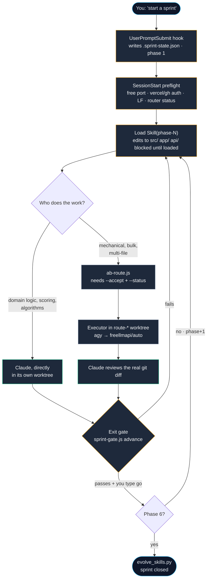
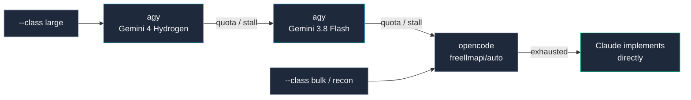

<p align="center">
  
</p>

<p align="center">
  
</p>

<p align="center">
  
  
  
  
</p>

<p align="center">
  
</p>

# Sprint System v3

A 6-phase, 5-hour build pipeline for Claude Code. You say **"start a sprint"**, and hooks hold Claude to the phase order. Each phase loads its skill first and ends at an exit gate that checks real output. Mechanical work goes to cheaper executors in isolated git worktrees. Claude keeps the domain logic and reviews every diff.

v3 rewrites v2 after the Sprint 1 post-mortem ([SPRINT-ISSUES.md](SPRINT-ISSUES.md)). Rules that v2 only wrote down are now hook checks that block the action ([SPRINT-fix.md](SPRINT-fix.md)).

---

## How a sprint runs



Amber is a hook that blocks the action, green is Claude, grey is a delegated executor.

## The six phases

<p align="center">
  
</p>

Budgets come from `sprint.config.json` (300 min total).

| # | Phase | Budget | Exit gate checks (`sprint-gate.js advance`) |
|---|---|---|---|
| 1 | discover | 30 min | `SPRINT.md`, `PRODUCT.md`, `DESIGN.md` and a golden fixture exist |
| 2 | backend | 60 min | `pytest` exits 0, at most 450 hand-written core backend LOC |
| 3 | frontend | 75 min | `.sprint/phase3-proof.json` has a human-click screenshot and `axeViolations: 0` |
| 4 | polish | 45 min | no gate; the user's `go` |
| 5 | audit | 45 min | no gate; the user's `go` |
| 6 | launch | 45 min | `.sprint/launch-proof.json` has a live URL with HTTP 200, the video length and README claims checked; a Stripe `cs_test_` session only when `gates.stripeEnabled` is true |

## What the hooks block

All checks live in [`scripts/hooks/sprint-gate.js`](scripts/hooks/sprint-gate.js). They do nothing unless `.sprint-state.json` has `active: true`. A block exits 2 with a `[BLOCKED]` reason sent to Claude.

| Hook | Blocks when |
|---|---|
| PreToolUse · Edit/Write | code edited before `Skill(phase-N)` is loaded · Phase 2+ code with Phase 1 artifacts missing · `.tsx/.jsx/.css/.html` edited before `.sprint/impeccable.ok` exists · the main checkout edited while a `route-*` worktree is live |
| PreToolUse · Bash | an `ab-route.js` write job (`bulk`, `large`, `agy`) without `--accept "<metric>"` or without `--status` run this phase · a Python heredoc in Git Bash on Windows |
| PostToolUse | never blocks: records loaded skills, flags slop in UI files (`bg-slate-950`, `from-purple-*`, `to-indigo-*`, `linear` transitions), logs router failures to `~/.agent-bridge/telemetry.jsonl` |
| Stop | stops Claude from ending its turn while a requested phase exit still fails its gate |

## Delegation

Work is sent through the router `~/.claude/bin/ab-route.js`, which lives outside this repo. Each write job runs in its own `route-*` worktree, and the router never pushes.



- If agy hasn't started within `agyStartupStallMs`, the router kills the attempt and drops agy for the rest of the sprint (`agyOneStrikeDrop`).
- A whole chain is capped at 10 minutes of wall clock (`maxChainWallMs`). After one failed chain, Claude implements the task directly.

## Sidebar mod (`sprint-mod/`)

A Claude Code mod that adds a sprint sidebar, a status-line row and four commands. It shows the current phase and time left, the gate state, delegated jobs, executor quotas and token use.

| Command | What it does |
|---|---|
| `/sprint` | Opens the sidebar: phases, handovers, executors, usage |
| `/sprint-status` | Prints the sprint status as text, without calling the model |
| `/sprint-agents` | Opens the Agents tab: live subagents, delegated jobs, worktrees; `btw` asks what an agent is doing without interrupting it |
| `/sprint-critiques` | Side-agent critiques held during a sprint: `apply` sends them through `ponytail-review`, `hold off` sends notes straight to Claude |

Sidebar keys: `c` compact · `g` agents · `r` refresh · `h` hud · `p` ponytail review · `a` advance.

## Setup

```powershell
git clone https://github.com/VihaanR/sprint-system.git V:\Projects\sprint
cd V:\Projects\sprint
python scripts/evolve_skills.py   # mirrors skills/ to ~/.claude/skills and ~/.gemini/config/skills
```

Then, in `~/.claude/settings.json`:

1. Load the mod: set `"env": { "CLAUDE_CODE_PLUGIN_DIRS": "V:/Projects/sprint/sprint-mod" }`.
2. Point the `UserPromptSubmit`, `PreToolUse`, `PostToolUse`, `PostToolUseFailure` and `Stop` hooks at `node V:/Projects/sprint/scripts/hooks/sprint-gate.js`.
3. Point `SessionStart` at `node V:/Projects/sprint/scripts/hooks/preflight.js`.

The hook scripts read the absolute path `V:/Projects/sprint`. If you clone somewhere else, edit those paths.

## Running a sprint

```text
start a sprint for <problem statement>
```

```bash
node ~/.claude/bin/ab-route.js --status                                   # once per phase, before any dispatch
node ~/.claude/bin/ab-route.js --class large --accept "pytest exit 0" "<outcome>"
node V:/Projects/sprint/scripts/hooks/sprint-gate.js advance                                 # after you type go
```

## Configuration

`sprint.config.json` controls the trigger phrases, phase budgets, router models and stall limits, gate thresholds (`backendMaxCoreLoc`, `maxCyclomaticComplexity`, `stripeEnabled`, `videoDurationSec`) and the UI checks (`requireImpeccable`, `requirePhase3HumanWalk`, `requireZeroAxeViolations`). A `sprint.config.json` in the project root overrides the one in this repo.

## Verify

```bash
node scripts/verify.mjs
```

This runs the mod tests (`claude plugin test sprint-mod`), `claude plugin validate`, `py_compile` on `scripts/*.py` and `node --check` on the hooks. It writes an evidence file to `~/.claude/verify-evidence/`, with `result: pass` only when every check exits 0.

## Layout

| Path | What |
|---|---|
| `skills/phase-*` | One skill per phase, loaded as the phase's first action |
| `skills/sprint-orchestrator` | Phase dispatcher and scorecard template |
| `.claude/agents/` | `discover`, `builder`, `auditor`, `launcher` subagent playbooks |
| `scripts/hooks/` | `sprint-gate.js` (all gates), `preflight.js` (SessionStart) |
| `sprint-mod/` | Sidebar, status line and commands |
| `AGENTS.md` | The rules any agent follows in this repo |
| `SPRINT-ISSUES.md` · `SPRINT-fix.md` | Sprint 1 post-mortem and the v3 spec it produced |

## License

MIT.
