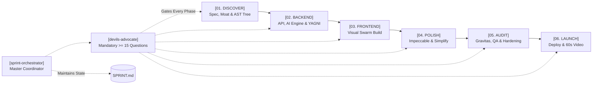

<p align="center">
  
</p>

<p align="center">
  
</p>

<p align="center">
  <a href="#pipeline"></a>
  <a href="#time-budget"></a>
  <a href="#toolchain"></a>
  <a href="LICENSE"></a>
</p>

---

## [SYSTEM OVERVIEW]

Developers and hackathon teams frequently have dozens of cutting-edge AI skills, plugins, and MCP servers available. During a competitive hackathon, tool execution often fractures into chaotic, ad-hoc prompting. Context windows overflow, verification passes get skipped, and prototypes end with unstyled interfaces or live runtime crashes during judging.

**Sprint System** enforces a disciplined, phase-based agentic operating system that orchestrates **21 plugins, 10 MCP servers, 30 global skills, and 4 AAS elite skills** into an automated pipeline designed to achieve a production-ready, judge-ready submission within **5 hours of prompting (1 day of work)**.

```
Problem Statement -> 6 Gated Phases (with Pre-Phase Interrogation >= 15 Questions) -> Judge-Ready Submission
```

---

## [PIPELINE]

<p align="center">
  
</p>



---

## [PRE-PHASE INTERROGATION GATE]

Before any sprint phase begins, the system enforces a mandatory two-step gate powered by `devils-advocate`:

1. **Executive Scorecard of Previous Phase (Gravitas Verified)**:
   - Elapsed sprint time vs 5-hour target budget.
   - Quantified deliverables backed by observed mechanical evidence (passing test suites, code 0 runs, DOM inspection).
   - Direct clickable links to generated artifacts (`docs/SPEC.md`, `PRODUCT.md`, schemas, `docs/ARCHITECTURE_TREE.md`).
   - Outstanding technical debt and carried risks.

2. **Strict Interactive Interrogation (Mandatory >= 15 Deep-Dive Questions)**:
   - **No Collapsing Allowed**: Agents are strictly forbidden from compressing questions into 3-4 summaries.
   - Halts execution until the user provides explicit answers and direction across all 5 dimensions:
     - **The Winning Moat & Anti-Slop** (Q01-Q03): Preventing generic ChatGPT-style slop.
     - **Custom Feature Wishlist & Signature Moments** (Q04-Q06): Demanding user-specified killer features and hero interactions.
     - **Technical Architecture & State Integrity** (Q07-Q09): State synchronization, query bottlenecks, and error fallbacks.
     - **Component Hierarchy & UX Microcopy** (Q10-Q12): Visual rhythm, scanability, and empathetic error messaging.
     - **Live Demo Failure Modes & Judge Scrutiny** (Q13-Q15): Pre-mortem analysis stress-testing judge scrutiny and offline failure.

3. **Addy Osmani Anti-Rationalization Filter**:
   - Zero tolerance for AI excuses (e.g. "skipping error handling for brevity", "mocking DB because it is slow"). Every phase transition requires complete, verified implementations.

---

## [RELIABILITY & EFFICIENCY PROTOCOLS]

### 1. `Gravitas` Engineering Reliability Runtime
- Prime Directive: *"Report what actually happened, not what you intended."*
- Prohibits editing unread files (scoped reconnaissance).
- Every claim of completion requires citing observed tool outputs (exit code 0, test pass counts, DOM inspection).

### 2. `i-have-adhd` Output Standard
- **Line 1 Action**: First line is always the next immediate executable command or technical action.
- **Minute Bounds**: Every planned step carries an explicit minute estimate (`[EST: X min]`).
- **Zero Padding**: Eliminates conversational filler, greetings, and pleasantries.

### 3. `Caveman` Adaptive Token Compression
- Slashes output tokens by **65-75%** during late-stage sprint runs and repetitive test/debug loops.
- Tiers: `/caveman lite`, `/caveman full`, `/caveman ultra`, `/caveman off`.
- Automatically recommended when session tokens exceed 70%.

### 4. `Ponytail` Ruthless YAGNI
- Anti-overengineering engine.
- Rule of concrete implementation: abstract only upon 3rd duplication.
- Provides `/ponytail-review` to measure and reward negative LOC (`-LOC`).

### 5. `Code-Simplify` Complexity Reducer
- Flattens nested conditionals (guard clauses, max depth <= 2).
- Eliminates promise chains; consolidates interdependent state variables.
- Provides `/code-simplify`.

### 6. `Understand-Anything` Post-Graphify AST Tree
- Chained immediately after `graphify` in Phase 1 & 5.
- Generates `docs/ARCHITECTURE_TREE.md` categorizing presentation, routing, domain, and persistence tiers.
- Offers interactive browser exploration:
  ```bash
  npx https://github.com/Egonex-AI/Understand-Anything/releases/latest/download/understand-anything-viewer.tgz .
  ```

### 7. `Agentic Awesome Skills` (AAS Core + Elite Bundle)
- Integrates AAS Core CLI (`npx agentic-awesome-skills`) for on-demand playbook discovery without prompt bloating.
- Curated elite bundle in `skills/aas/`:
  - `security-hardening.md`: Timing-safe comparisons, sanitization, security headers.
  - `chaos-testing.md`: Latency injection and simulated service degradation.
  - `micro-benchmark.md`: Microsecond loop and serialization profiling.
  - `memory-leak-hunter.md`: Unclosed handles, dangling listeners, heap growth checks.

---

## [PHASE SPECIFICATIONS]

### `[PHASE 01: DISCOVER]` (Target: ~30 min)
* **Pre-Phase Gate**: `devils-advocate` probes problem statement validity, persona, and technical moat (>= 15 questions).
* **Objective**: Technical scoping, competitor benchmarking, competitive moat definition, API contract, relational schema, and AST architecture tree.
* **Active Tooling**: `research` subagent, `impeccable` (init / shape), `api-anything` MCP, `context7`, `api-design-principles`, `mermaid-expert`, `mobbin` MCP, `StitchMCP`, `graphify`, `understand-anything`, `gravitas`.
* **Output**: `PRODUCT.md`, `docs/SPEC.md`, `docs/ARCHITECTURE_TREE.md`, OpenAPI schema, relational ERD.

### `[PHASE 02: BACKEND]` (Target: ~60 min)
* **Pre-Phase Gate**: Phase 1 Scorecard + `devils-advocate` probes concurrency, data persistence, and API schemas (>= 15 questions).
* **Objective**: Core engine implementation, database persistence, Gemini LLM/RAG pipelines, un-APId live web data ingestion, Ponytail YAGNI lean state, and endpoint verification.
* **Active Tooling**: `fastapi-pro`, `ponytail` (YAGNI), `gemini-api`, `rag-implementation`, `prompt-engineering-patterns`, `api-anything` MCP, `sqlite` MCP, `fetch` MCP, `docker` MCP, `postman`, `gravitas`.
* **Output**: Operational async FastAPI backend with populated database, mechanical curl proofs, and passing pytest suite.

### `[PHASE 03: FRONTEND]` (Target: ~75 min)
* **Pre-Phase Gate**: Phase 2 Scorecard + `devils-advocate` probes component hierarchy, state sync, and killer interactions (>= 15 questions).
* **Objective**: Component assembly and state binding using a visible multi-agent parallel swarm with Hot Module Replacement, Ponytail YAGNI lean components, and Impeccable craft-floor rules.
* **Active Tooling**: `live-swarm-coding` (`resources/swarm-overlay.js`), `ponytail` (YAGNI), `impeccable` (craft-floor & live variants), `react-state-management`, `react-modernization`, `browser-code-verifier`, `chrome-devtools-plugin`, `StitchMCP`, `gravitas`.
* **Output**: Live interactive UI connected to backend endpoints with zero generic purple gradients and zero unhandled console errors.

### `[PHASE 04: POLISH]` (Target: ~45 min)
* **Pre-Phase Gate**: Phase 3 Scorecard + `devils-advocate` probes design compromises, bland layouts, and typography (>= 15 questions).
* **Objective**: Elevating the interface with design intelligence, typography scales, zero generic AI slop, `/code-simplify` complexity reduction, and responsive fluidity.
* **Active Tooling**: `impeccable` (`/impeccable polish`, `/impeccable critique`, `/impeccable bolder`, `npx impeccable detect`), `code-simplify` (Addy Osmani), `ui-ux-pro-max`, `tailwind-design-system`, `ui-visual-validator`, `indian-gov-ui-skills` (if public/bilingual/gov), `gravitas`.
* **Output**: High-contrast OLED Dark or Glassmorphic visual presentation with zero layout shifts, flattened code complexity, and zero AI slop.

### `[PHASE 05: AUDIT]` (Target: ~45 min)
* **Pre-Phase Gate**: Phase 4 Scorecard + `devils-advocate` probes attack vectors, auth scopes, and crash recovery (>= 15 questions).
* **Objective**: DevSecOps security scanning, Ponytail negative-LOC audit, AST tree verification, AAS elite hardening, automated Playwright headless tests, telemetry, and Gravitas evidence-backed sign-off.
* **Active Tooling**: `security-auditor`, `gravitas`, `ponytail` (/ponytail-review), `understand-anything`, `aas` (security/chaos/benchmark/leak), `impeccable` (harden / audit), `coderabbit`, `sentry`, `playwright` MCP, `api-anything` MCP, `chrome-devtools-plugin`, `e2e-testing-patterns`.
* **Output**: `docs/AUDIT_REPORT.md` with verified security clean bill, negative-LOC audit, and zero runtime errors.

### `[PHASE 06: LAUNCH]` (Target: ~45 min)
* **Pre-Phase Gate**: Phase 5 Scorecard + `devils-advocate` probes deployment latency, judge friction, and video narrative (>= 15 questions).
* **Objective**: Live production deployment, Gravitas HTTP 200 verification, 60-second Hyperframes launch video, interactive Swagger documentation, and judge-facing pitch documentation.
* **Active Tooling**: `brag` (Hyperframes video engine), `vercel-plugin`, `railway`, `firebase`, `openapi-spec-generation`, `git-advanced-workflows`, `mermaid-expert`, `gravitas`.
* **Output**: Live deployed production URL, verified 60s demo pitch video, and comprehensive `README.md`.

---

## [TOOLCHAIN MASTER MATRIX]

```mermaid
flowchart TD
    subgraph P1 ["[01. DISCOVER & SPEC]"]
        t1["Gate: devils-advocate (>= 15 questions)<br/>Plugins: superpowers, context7, google-developer-knowledge, gdocs<br/>MCPs: mobbin, StitchMCP, github-mcp-server, graphify, api-anything<br/>Skills: impeccable, api-anything, api-design, mermaid-expert, graphify, understand-anything, gravitas"]
    end

    subgraph P2 ["[02. BACKEND, AI & DATA]"]
        t2["Gate: devils-advocate (>= 15 questions)<br/>Plugins: gemini-api, google-antigravity-sdk, data-agent-kit, firebase, postman, google_maps<br/>MCPs: sqlite, fetch, docker, firebase-mcp-server, api-anything<br/>Skills: fastapi-pro, ponytail (YAGNI), rag, prompt-engineering, api-anything, async-python, sql, gravitas"]
    end

    subgraph P3 ["[03. FRONTEND VISUAL SWARM]"]
        t3["Gate: devils-advocate (>= 15 questions)<br/>Plugins: browser-code-verifier, chrome-devtools, android-cli, flutter, modern-web-guidance<br/>MCPs: StitchMCP<br/>Skills: live-swarm-coding, ponytail (YAGNI), impeccable, react-state, react-modernization, gravitas"]
    end

    subgraph P4 ["[04. BEAUTIFICATION & POLISH]"]
        t4["Gate: devils-advocate (>= 15 questions)<br/>Plugins: modern-web-guidance, indian-gov-ui-skills (GIGW/UX4G)<br/>MCPs: mobbin, StitchMCP<br/>Skills: impeccable, code-simplify (Addy Osmani), ui-ux-pro-max, tailwind-design-system, ui-visual-validator, gravitas"]
    end

    subgraph P5 ["[05. DEVSECOPS & QA AUDIT]"]
        t5["Gate: devils-advocate (>= 15 questions)<br/>Plugins: coderabbit, sentry, chrome-devtools, indian-gov-ui-skills (WCAG)<br/>MCPs: playwright, graphify, api-anything<br/>Skills: security-auditor, gravitas, ponytail (/ponytail-review), understand-anything, aas (elite bundle), e2e-testing"]
    end

    subgraph P6 ["[06. PRODUCTION LAUNCH]"]
        t6["Gate: devils-advocate (>= 15 questions)<br/>Plugins: brag (video), vercel-plugin, railway, firebase, postman, gdocs<br/>MCPs: github-mcp-server<br/>Skills: brag, gravitas (URL proof), openapi-spec-generation, git-advanced-workflows, mermaid-expert"]
    end

    P1 --> P2 --> P3 --> P4 --> P5 --> P6
```



---

## [SLASH COMMANDS]

| Command | Engine | Purpose |
| :--- | :--- | :--- |
| `/ponytail-review` | `ponytail` | Anti-overengineering review measuring negative LOC and deleting speculative code. |
| `/code-simplify` | `code-simplify` | Flattens control flows, reduces cyclomatic complexity, and consolidates state variables. |
| `/caveman [tier]` | `caveman` | Engages token compression (`lite`, `full`, `ultra`, `off`) to save 65-75% tokens. |
| `/impeccable polish` | `impeccable` | Anti-slop design polish stripping generic AI templates and balancing spacing. |
| `/impeccable bolder` | `impeccable` | Elevates timid typography, accentuates contrast, and injects visual confidence. |
| `/grill-me` | `devils-advocate` | Triggers the adversarial pre-phase interrogation gate with >= 15 deep-dive questions. |

---

## [QUICKSTART]

### Installation in Google Antigravity

```powershell
# Clone the repository
git clone https://github.com/VihaanR/sprint-system.git

# Copy skills to your global Antigravity discovery path
Copy-Item -Path "sprint-system\skills\*" -Destination "$HOME\.gemini\config\skills\" -Recurse -Force
```

### Installation in Claude Code / Cursor / Codex

```bash
# Copy skills into cross-agent directory
cp -r sprint-system/skills/* ~/.agents/skills/
```

### Starting a Sprint

Initiate any new project or hackathon prompt:
> **"Start sprint for [Project Name / Problem Statement]"**

The orchestrator initializes `SPRINT.md`, maintains time budgets, executes subagents autonomously within each phase, and halts before each phase to deliver the **Executive Scorecard** and conduct the **Devil's Advocate Interrogation (>= 15 Questions)**.

---

## [LICENSE]

MIT License. Designed for hackathon competitors, builders, and autonomous engineering workflows.
