<p align="center">
  
</p>

<p align="center">
  
</p>

<p align="center">
  <a href="#pipeline"></a>
  <a href="#time-budget"></a>
  <a href="#toolchain"></a>
  <a href="#plugins"></a>
  <a href="LICENSE"></a>
</p>

<p align="center">
  
</p>

---

## [SYSTEM OVERVIEW]

Developers and hackathon teams frequently have dozens of cutting-edge AI skills, plugins, and MCP servers available. During a competitive hackathon, tool execution often fractures into chaotic, ad-hoc prompting. Context windows overflow, verification passes get skipped, and prototypes end with unstyled interfaces, generic AI slop, or live runtime crashes during judging.

**Sprint System v2.0** enforces a disciplined, phase-based agentic operating system that orchestrates **30 plugins, 10 MCP servers, and 320 installed skills** into an automated pipeline designed to achieve a production-ready, judge-winning submission within **5 hours of prompting (1 day of work)**.

Governed by the **9-Faction Architectural Grand Accord**, Sprint System v2.0 reconciles extreme velocity with unassailable technical depth, zero AI slop, and tactile aesthetic excellence.

```
Problem Statement -> 6 Gated Phases (with 45s Interactive Gate) -> Judge-Ready Submission
```

---

## [THE 9-FACTION ARCHITECTURAL GRAND ACCORD]

Sprint System v2.0 is powered by the synthesis of 9 specialized architectural factions:

1. **Faction 1 (YAGNI & Minimalist Core - `ponytail`, Karpathy's 4 Rules)**: Concrete collocated monolith first, zero generic repository/service wrappers, single living artifact `SPRINT.md`, negative lines of code prioritized over lines added.
2. **Faction 2 (Adversarial Moat - `devils-advocate`, Pocock `/grill-me`)**: 15-question pre-mortem rigor, compound reasoning moat, and mandatory `DEMO_MODE=offline` resilient local fixtures so conference Wi-Fi failures never kill a live demo.
3. **Faction 3 (TRIZ Innovation - `egm-inventive-catalyst`, `superpowers`)**: Eliminates false compromises via 2-tier discovery interrogation (12 questions auto-resolved by heuristics in <2s; 3 strategic choices in 1 interactive `ask_question` card in 45s), minute-1 immutable kernel contract (`types.ts`), and dynamic feature slice registries (`import.meta.glob`).
4. **Faction 4 (Agentic UI - Vercel Chat SDK, `modern-web-guidance`)**: Streaming token HUD, native semantic HTML5 (`<dialog>`, `<popover>`, `<details>`, container queries `@container`), zero npm wrapper bloat, and `browser-code-verifier` DOM/CLS assertions.
5. **Faction 5 (Platform & Swarm - Antigravity Guide, native MCP, worktrees)**: Strict JSON-RPC MCP routing, zero-copy shared worktrees (`workspace: "share"`), zero-cost WebGL sidecars (`sidecar://`), and Active Context Pruning (ACP) keeping memory < 35%.
6. **Faction 6 (Zero-Trust Security & QA - `AgentShield`, `security-auditor`, `gravitas`, `firestore-rules-author`)**: Out-of-band pre-commit AST scans, declarative security rules subagents, and exit code 0 mechanical verification gates.
7. **Faction 7 (Cloud & Deep-Tech Launch - Vercel, Railway, Stripe, Remotion, `science`)**: Zero-Localhost Ironclad Gate (live edge URL returning HTTP 200 within 2s), instant Stripe test checkout session (`cs_test_...`), Remotion React code-video with animated WebP/GIF fallback, and deep-tech domain grounding.
8. **Faction 8 (Anti-AI Slop - `impeccable`, `code-simplify`, `egm-style`)**: Mechanical Anti-Slop Linter with Auto-Fix and Hard Failback (Exit Code 1). Bans purple-indigo hero gradients, decorative sparkle icons, fake hardcoded metric claims, and marketing buzzwords. Enforces `egm-style` factual technical claims.
9. **Faction 9 (Sleek UI/UX - `ui-ux-pro-max`, `antigravity-design-expert`, `tailwind-design-system`, `motion-graphics`, `mobbin`)**: Multi-layer Z-axis spatial depth, calibrated glassmorphism (`backdrop-filter: blur(16px)`), sub-pixel border highlights (`1px solid rgba(255,255,255,0.08)`), 3D perspective transforms (`perspective: 1000px`), global command palette (`Cmd+K`), 12 Laws of Motion with non-linear bezier curves, and Authentic Notebook Sketch Dynamic when sketch mode is active.

---

## [PIPELINE]

<p align="center">
  
</p>

---

## [TOOLCHAIN MASTER MATRIX]

<p align="center">
  
</p>

| Phase | Target Budget | Core Objective | Primary Plugins | Active MCP Servers | Activated Skills | Key Deliverable |
| :--- | :--- | :--- | :--- | :--- | :--- | :--- |
| **01. Discover** | ~30 min | Spec, Moat, Contracts & Architecture | `superpowers`, `context7`, `google-developer-knowledge`, `gdocs`, `science`, `browse` | `graphify`, `mobbin`, `StitchMCP`, `api-anything`, `github` | `devils-advocate`, `impeccable` (init/shape), `understand-anything`, `api-anything`, `api-design-principles`, `mermaid-expert`, `gravitas` | `SPRINT.md`, `ARCHITECTURE_TREE.md`, Offline Fixtures |
| **02. Backend** | ~60 min | Monolith Core, AI/RAG, Auth & Stripe | `gemini-api`, `google-antigravity-sdk`, `data-agent-kit`, `firebase`, `postman`, `auth0`, `stripe`, `science` | `sqlite`, `fetch`, `docker`, `firebase-mcp`, `api-anything` | `fastapi-pro` (or Next.js for SaaS), `ponytail` (YAGNI), `rag-implementation`, `prompt-engineering`, `async-python`, `sql-opt`, `gravitas` | Concrete Monolith API, Stripe Checkout, Pytest Pass (Exit 0) |
| **03. Frontend** | ~75 min | Zero-Slop Swarm Assembly & State | `browser-code-verifier`, `chrome-devtools`, `android-cli`, `flutter`, `modern-web-guidance`, `gdrive` | `StitchMCP` | `live-swarm-coding`, `impeccable` (craft-floor), `ui-ux-pro-max`, `tailwind-design-system`, `react-state-management`, `gravitas` | Native HTML5 UI, Cmd+K, Anti-Slop Linter Pass |
| **04. Polish** | ~45 min | Sleek Motion, Z-Depth & Copy Purge | `modern-web-guidance`, `indian-gov-ui-skills` (if gov/bilingual/public) | `mobbin`, `StitchMCP`, `science_biomolecular_structure_viewer_mcp` | `motion-graphics` (12 animation laws), `code-simplify` (Addy Osmani), `egm-style` (copy purge), `antigravity-design-expert` (3D tilt), `ui-visual-validator` | Calibrated Glassmorphism, 60fps Deceleration, Zero Slop |
| **05. Audit** | ~45 min | 2-Pass Map-Reduce & Hardening | `coderabbit`, `sentry`, `chrome-devtools`, `indian-gov-ui-skills` (WCAG AA) | `playwright`, `graphify`, `api-anything` | `security-auditor`, `AgentShield`, `gravitas` (evidence pass), `ponytail-review` (-LOC), `egm-implementation-readiness`, `aas` (elite bundle) | `docs/AUDIT_REPORT.md`, Negative LOC, 0 A11y Violations |
| **06. Launch** | ~45 min | Zero-Localhost Gate & Remotion Video | `brag`, `vercel`, `railway`, `firebase`, `postman`, `gdocs` | `github-mcp-server` | `remotion-best-practices` (React video), `brag` (video gen), `gravitas` (HTTP 200 proof), `openapi-spec-generation`, `mermaid-expert` | Deployed Edge URL (200 OK), 60s Video MP4, Pitch README |

---

## [MECHANICAL ANTI-SLOP LINTER RULES]

Sprint System v2.0 enforces automated pre-commit and audit linting with **Auto-Fix and Hard Failback (Exit Code 1)**:

| Rule Identifier | Target Violation | Enforcement Action |
| :--- | :--- | :--- |
| `anti-slop/no-banned-lexicon` | Copy containing: *"seamless"*, *"seamlessly"*, *"elevate"*, *"supercharge"*, *"unleash"*, *"cutting-edge"*, *"game-changing"*, *"next-generation"*, *"empower"*, *"say goodbye to"* | **FAIL (Exit 1)**. Enforces `egm-style` factual, technical active voice. |
| `anti-slop/no-slop-gradients` | CSS containing `bg-gradient-to-r from-purple-* to-indigo-*` or `from-violet-* to-fuchsia-*` hero backgrounds | **FAIL (Exit 1)**. Enforces solid, high-contrast, domain structural palettes. |
| `anti-slop/no-decorative-sparkles` | Non-functional SVG `<Sparkles`, `<Wand`, or AI sparkle badges used for visual garnish | **FAIL (Exit 1)**. Sparkles permitted ONLY on active AI prompt submission inputs. |
| `anti-slop/no-fake-metrics` | Static text containing hardcoded claims like `"99.9%"`, `"10x Faster"`, `"50k+ Users"` | **FAIL (Exit 1)**. Metrics must be backed by live database counts or benchmark files. |
| `code-simplify/max-cyclomatic` | Functions with nesting depth > 2 or cyclomatic complexity > 6 | **FAIL (Exit 1)**. Enforces Addy Osmani's early return pattern and discriminated union states. |

---

## [RELIABILITY & EFFICIENCY PROTOCOLS]

| Engine | Origin | Core Invariant | Impact on Sprint |
| :--- | :--- | :--- | :--- |
| **`Gravitas`** | `udaysharmadev/Gravitas` | *"Report what actually happened, not what you intended."* | Prohibits blind edits (scoped reconnaissance); requires citing observed tool outputs (exit 0, test counts, DOM inspection). |
| **`i-have-adhd`** | `ayghri/i-have-adhd` | Action-first syntax with explicit minute bounds (`[EST: X min]`). | Eliminates conversational filler, greetings, and pleasantries. Slashes cognitive fatigue and turns directly into execution. |
| **`Caveman`** | `juliusbrussee/caveman` | Extreme token compression (`lite`, `full`, `ultra`). | Slashes output tokens by **65-75%** during late-stage sprint runs and repetitive test/debug loops to preserve context headroom. |
| **`Ponytail`** | `dietrichgebert/ponytail` | Ruthless YAGNI. Abstract only upon third duplication. | Bans speculative microservices, single-use interfaces, and premature wrappers. Measures and rewards negative LOC (`-LOC`). |
| **`Code-Simplify`** | `addyosmani/agent-skills` | Early return guards, flattened promises, state consolidation. | Flattens control flows (max nesting <= 2), eliminates promise callback chains, and enforces the Anti-Rationalization matrix. |
| **`ACP`** | `ranxianglei/billion-context` | Active Context Pruning, disk-offload, and phase condensation. | Flushes verbose terminal traces to `SPRINT.md`/`docs/`, prevents context exhaustion, and keeps memory < 35%. |
| **`Understand-Anything`** | `Egonex-AI/Understand-Anything` | AST architecture tree generator & interactive browser viewer. | Maps presentation, routing, domain, and persistence tiers into `docs/ARCHITECTURE_TREE.md`. |
| **`Remotion`** | `remotion-best-practices` | Frame-accurate React programmatic video rendering with spring physics. | Replaces generic AI video with code-rendered timelines and static preloading. |
| **`Motion-Graphics`** | `omer-metin/skills-for-antigravity` | 12 Principles of Animation, non-linear easing, timing & spacing. | Enforces `cubic-bezier(0.25, 1, 0.5, 1)` and organic squash-and-stretch. |
| **`Antigravity-Design`** | `sickn33/agentic-awesome-skills` | Spatial depth, weightlessness, GSAP ScrollTrigger & R3F 3D. | Directs multi-layer parallax, hardware 3D transforms (`rotateX`, `rotateY`), and glassmorphism. |

---

## [MOTION DESIGN & ANIMATION STANDARDS]

All visual components and motion timelines follow strict organic engineering standards:

1. **Code-Based Video & UI Engines**:
   - Use **Remotion** for programmatic React/TypeScript video generation with deterministic frame rendering (`useCurrentFrame()`).
   - Use **GSAP** and **Tailwind CSS** for interactive web animations and scroll-linked spatial movements.
2. **Controlled Non-Linear Easing & Timing**:
   - Never use linear transitions (`linear`).
   - Standard deceleration: `cubic-bezier(0.25, 1, 0.5, 1)`.
   - Elastic settling bounce: `cubic-bezier(0.34, 1.56, 0.64, 1)`.
3. **Staggered Entrances**:
   - Stagger sequential element reveals with explicit 50ms offsets (`animation-delay: calc(var(--index) * 50ms)`).
4. **Z-Axis & Parallax Depth**:
   - Multi-layer spatial planes with hardware-accelerated 3D perspective transforms (`perspective: 1000px`, `backdrop-filter: blur(16px)`, `1px solid rgba(255,255,255,0.08)`).
5. **Authentic Notebook Sketch & Doodle Standard (When Active)**:
   - Authentic cream notebook paper canvas (`#FCFBF7`) with blue horizontal ruled lines and red vertical left margin line.
   - Graphite pencil and ink lines (`#18181B`) with squash-and-stretch dynamics.

---

## [SLASH COMMANDS & PIPELINE AUTOMATION]

| Command | Engine | Automated Sprint Phase | Standalone On-Demand Purpose |
| :--- | :--- | :--- | :--- |
| `/ponytail-review` | `ponytail` | Auto-executed in Phase 2, 3, & 5 | Anti-overengineering review measuring negative LOC and deleting speculative code. |
| `/code-simplify` | `code-simplify` | Auto-executed in Phase 4 (Polish) | Flattens control flows, reduces cyclomatic complexity, and consolidates state variables. |
| `/acp` | `acp` | Auto-executed at Phase transitions | Active Context Pruning: flushes pending state to SPRINT.md, gates /compact, and keeps memory < 35%. |
| `/caveman [tier]` | `caveman` | Auto-recommended at >70% tokens | Manual token compression (`lite`, `full`, `ultra`, `off`) to save 65-75% tokens. |
| `/impeccable polish` | `impeccable` | Auto-executed in Phase 4 (Polish) | Anti-slop design polish stripping generic AI templates and balancing spacing. |
| `/grill-me` | `devils-advocate` | Auto-executed before Phase 1 | Triggers the 45-second interactive gate with native `ask_question` modal card. |

---

## [QUICKSTART]

### Installation in Google Antigravity

```powershell
# Clone the repository
git clone https://github.com/VihaanR/sprint-system.git

# Copy skills to your global Antigravity discovery path
Copy-Item -Path "sprint-system\skills\*" -Destination "$HOME\.gemini\config\skills\" -Recurse -Force
```

### Starting a Sprint

Initiate any new project or hackathon prompt:
> **"Start sprint for [Project Name / Problem Statement]"**

The orchestrator initializes `SPRINT.md`, maintains time budgets, executes subagents autonomously within each phase, delivers the **Executive Scorecard**, and conducts the **45-second Interactive Gate**.

---

## [LICENSE]

MIT License. Designed for hackathon competitors, builders, and autonomous engineering workflows.
