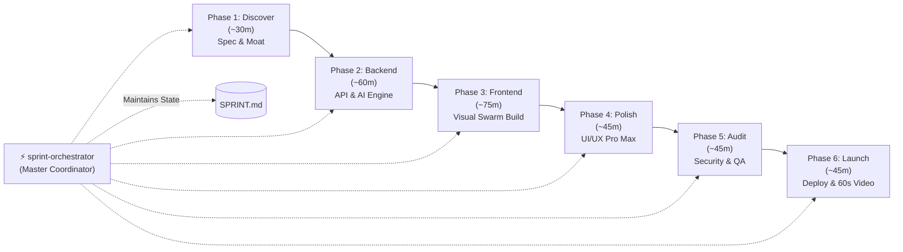
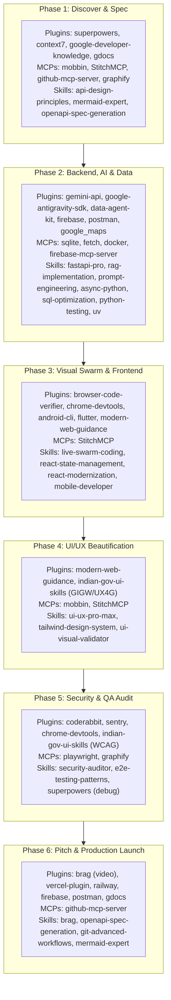

# ⚡ Sprint System

> **The 5-Hour Global Hackathon Operating System for AI Coding Agents**  
> *Inspired by [`affaan-m/ecc`](https://github.com/affaan-m/ecc), designed for Google Antigravity, Claude Code, and Cursor.*

[](https://opensource.org/licenses/MIT)
[](https://antigravity.google)
[](#the-6-sprint-phases)
[](#time-budget--fast-gated-autonomy)

---

## 🎯 The Problem

Developers and hackathon competitors frequently have dozens of cutting-edge AI skills, plugins, and MCP servers at their disposal—yet during a time-crunched hackathon, tool execution degrades into chaotic, ad-hoc prompting. Context windows overflow, critical verification steps get skipped, and projects end with unstyled UIs or fatal runtime crashes during live judging.

**Sprint System** solves this by enforcing a disciplined, phase-based agentic operating system that orchestrates **21+ plugins, 9 MCP servers, and 22 skills** into an automated, production-ready pipeline.

$$\text{Problem Statement} \longrightarrow \mathbf{5\text{ Hours of Prompting}} \longrightarrow \text{Global Hackathon Winning Submission}$$

---

## 🏗️ The 6-Phase Pipeline



---

## ⏱️ Time Budget & Phase Breakdown

| Phase | Duration | Core Goal | Key Deliverables |
|---|---|---|---|
| **Phase 1: `phase-discover`** | ~30 min | Problem Scoping & Moat | `docs/SPEC.md`, winning hook, OpenAPI schema, Mermaid ERD |
| **Phase 2: `phase-backend`** | ~60 min | Core Engine & Data Layer | Async FastAPI, SQLite/Postgres persistence, Gemini API/RAG, passing pytest suite |
| **Phase 3: `phase-frontend`** | ~75 min | Visual Swarm Assembly | Hot-reloaded UI assembly via `live-swarm-coding` with parallel agent cursors |
| **Phase 4: `phase-polish`** | ~45 min | Beautification & Aesthetics | OLED Dark / Glassmorphic styling, typography scale, Phosphor icons, microcopy |
| **Phase 5: `phase-audit`** | ~45 min | Security & Verification | OWASP scan (`security-auditor`), Playwright E2E smoke tests, 0 console errors |
| **Phase 6: `phase-launch`** | ~45 min | Judge-Ready Demo Pack | Live production URL, 60s `brag` demo video, Swagger UI, killer `README.md` |

---

## 🗺️ Complete Toolchain Master Matrix

The system dynamically activates the right tools based on the current phase:



---

## 🎨 The Multi-Agent Visual Swarm (`live-swarm-coding`)

Includes a standalone visual engine (`skills/live-swarm-coding/resources/swarm-overlay.js`) delivering the viral **`pen.dev` multiplayer canvas aesthetic** directly over your live React/HTML browser window:

* 🟣 **Agent Orion**: Layout, Flexbox, & Grid hierarchy.
* 🟢 **Agent Lyra**: Glassmorphic styling, Tailwind colors, & gradients.
* 🟠 **Agent Echo**: Reactive state, event listeners, & hooks.
* 🔵 **Agent Nova**: Real-time WCAG accessibility validator.
* **Selection Bounding Boxes**: Dashed, animated outline boxes that snap around components being actively edited.
* **Code Streamers**: Floating syntax-highlighted pills displaying diffs in real time.

---

## 🚀 Quickstart & Installation

### Option 1: In Google Antigravity
Clone or copy the `skills/` directory into your global Antigravity config:

```powershell
git clone https://github.com/VihaanR/sprint-system.git
Copy-Item -Path "sprint-system\skills\*" -Destination "$HOME\.gemini\config\skills\" -Recurse -Force
```

To kick off a project:
> **"Start sprint for [Your Hackathon Project Idea]"**

### Option 2: In Claude Code / Cursor / Codex
Copy the `skills/` folders to your agent skills directory (`~/.claude/skills/` or `~/.agents/skills/`):

```bash
cp -r sprint-system/skills/* ~/.agents/skills/
```

---

## 📋 The `SPRINT.md` Checkpoint Workflow

Every project initializes a root `SPRINT.md` tracking file. The system enforces **Fast-Gated Autonomy**:

1. Subagents execute the current phase autonomously.
2. The orchestrator updates `SPRINT.md` with a 3-bullet summary of completed deliverables.
3. The agent pauses for your 1-click confirmation before moving to the next phase:
   > *"Phase 2 complete. All 6 endpoints verified via fetch MCP. Proceed to Phase 3 (Frontend)?"*

---

## 📄 License

MIT License. Crafted for builders, hackers, and autonomous software engineers.
