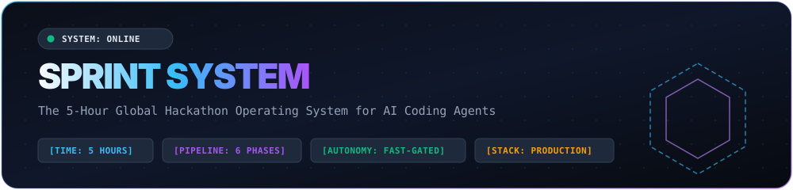
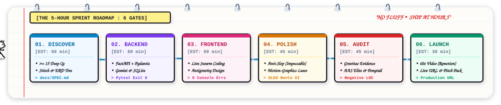
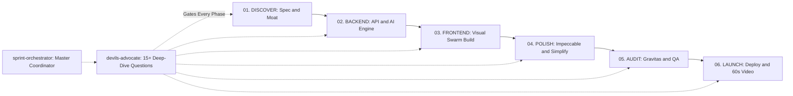
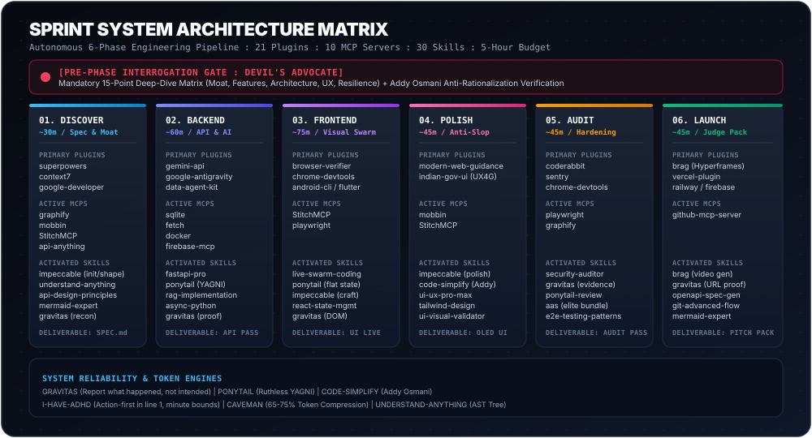

<p align="center">
  
</p>

<p align="center">
  
</p>

<p align="center">
  <a href="#pipeline"></a>
  <a href="#time-budget"></a>
  <a href="#toolchain"></a>
  <a href="LICENSE"></a>
</p>

---

## [SYSTEM OVERVIEW]

Developers and hackathon teams frequently have dozens of cutting-edge AI skills, plugins, and MCP servers available. During a competitive hackathon, tool execution often fractures into chaotic, ad-hoc prompting. Context windows overflow, verification passes get skipped, and prototypes end with unstyled interfaces or live runtime crashes during judging.

**Sprint System** enforces a disciplined, phase-based agentic operating system that orchestrates **21 plugins, 10 MCP servers, 30 global skills, and 4 AAS elite skills** into an automated pipeline designed to achieve a production-ready, judge-ready submission within **5 hours of prompting (1 day of work)**.

```
Problem Statement -> 6 Gated Phases (with Pre-Phase Interrogation >= 15 Questions) -> Judge-Ready Submission
```

---

## [PIPELINE]

<p align="center">
  
</p>



---

## [TOOLCHAIN MASTER MATRIX]

<p align="center">
  
</p>

| Phase | Target Budget | Core Objective | Primary Plugins | Active MCP Servers | Activated Skills | Key Deliverable |
| :--- | :--- | :--- | :--- | :--- | :--- | :--- |
| **01. Discover** | ~30 min | Spec, Moat, Contracts & Architecture | `superpowers`, `context7`, `google-developer-knowledge`, `gdocs` | `graphify`, `mobbin`, `StitchMCP`, `api-anything`, `github` | `impeccable` (init/shape), `understand-anything`, `api-anything`, `api-design-principles`, `mermaid-expert`, `gravitas` | `docs/SPEC.md`, `ARCHITECTURE_TREE.md` |
| **02. Backend** | ~60 min | Core Engine, AI/RAG, APIs & Data Layer | `gemini-api`, `google-antigravity-sdk`, `data-agent-kit`, `firebase`, `postman`, `google-maps` | `sqlite`, `fetch`, `docker`, `firebase-mcp`, `api-anything` | `fastapi-pro`, `ponytail` (YAGNI), `rag-implementation`, `prompt-engineering`, `async-python`, `sql-opt`, `gravitas` | Async API, DB Models, Pytest Pass (Exit 0) |
| **03. Frontend** | ~75 min | Visual Swarm Assembly & State Binding | `browser-code-verifier`, `chrome-devtools`, `android-cli`, `flutter`, `modern-web-guidance` | `StitchMCP`, `playwright` | `live-swarm-coding`, `ponytail` (flat state), `impeccable` (craft-floor/live), `react-state-management`, `gravitas` | Interactive Live UI, 0 Console Errors |
| **04. Polish** | ~45 min | Design Intelligence, Tokens & Motion | `modern-web-guidance`, `indian-gov-ui-skills` (GIGW/UX4G) | `mobbin`, `StitchMCP` | `impeccable` (polish/critique/bolder/detect), `code-simplify` (Addy Osmani), `ui-ux-pro-max`, `tailwind-design-system`, `ui-visual-validator` | OLED Dark / Bento UI, Flattened Complexity |
| **05. Audit** | ~45 min | DevSecOps Security, E2E QA & Hardening | `coderabbit`, `sentry`, `chrome-devtools`, `indian-gov-ui-skills` (WCAG AA) | `playwright`, `graphify`, `api-anything` | `security-auditor`, `gravitas` (evidence pass), `ponytail-review` (-LOC), `understand-anything` (tree audit), `aas` (elite bundle) | `docs/AUDIT_REPORT.md`, Negative LOC |
| **06. Launch** | ~45 min | Live URL, 60s Video Demo & Pitch Pack | `brag` (Hyperframes), `vercel`, `railway`, `firebase`, `postman`, `gdocs` | `github-mcp-server` | `brag` (video gen), `gravitas` (HTTP 200 proof), `openapi-spec-generation`, `git-advanced-workflows`, `mermaid-expert` | Deployed URL, 60s Launch Video, Pitch README |

---

## [PRE-PHASE INTERROGATION GATE]

Before any sprint phase begins, the system enforces a mandatory two-step gate powered by `devils-advocate`:

1. **Executive Scorecard of Previous Phase (Gravitas Verified)**:
   - Elapsed sprint time vs 5-hour target budget.
   - Quantified deliverables backed by observed mechanical evidence (passing test suites, code 0 runs, DOM inspection).
   - Direct clickable links to generated artifacts (`docs/SPEC.md`, `PRODUCT.md`, schemas, `docs/ARCHITECTURE_TREE.md`).
   - Outstanding technical debt and carried risks.

2. **Strict Interactive Interrogation (Mandatory >= 15 Deep-Dive Questions)**:
   - **No Collapsing Allowed**: Agents are strictly forbidden from compressing questions into 3-4 summaries.
   - Halts execution until the user provides explicit answers and direction across all 5 dimensions:
     - **The Winning Moat & Anti-Slop** (Q01-Q03): Preventing generic ChatGPT-style slop.
     - **Custom Feature Wishlist & Signature Moments** (Q04-Q06): Demanding user-specified killer features and hero interactions.
     - **Technical Architecture & State Integrity** (Q07-Q09): State synchronization, query bottlenecks, and error fallbacks.
     - **Component Hierarchy & UX Microcopy** (Q10-Q12): Visual rhythm, scanability, and empathetic error messaging.
     - **Live Demo Failure Modes & Judge Scrutiny** (Q13-Q15): Pre-mortem analysis stress-testing judge scrutiny and offline failure.

3. **Addy Osmani Anti-Rationalization Filter**:
   - Zero tolerance for AI excuses (e.g. "skipping error handling for brevity", "mocking DB because it is slow"). Every phase transition requires complete, verified implementations.

---

## [RELIABILITY & EFFICIENCY PROTOCOLS]

| Engine | Origin | Core Invariant | Impact on Sprint |
| :--- | :--- | :--- | :--- |
| **`Gravitas`** | `udaysharmadev/Gravitas` | *"Report what actually happened, not what you intended."* | Prohibits blind edits (scoped reconnaissance); requires citing observed tool outputs (exit 0, test counts, DOM inspection). |
| **`i-have-adhd`** | `ayghri/i-have-adhd` | Action-first syntax with explicit minute bounds (`[EST: X min]`). | Eliminates conversational filler, greetings, and pleasantries. Slashes cognitive fatigue and turns directly into execution. |
| **`Caveman`** | `juliusbrussee/caveman` | Extreme token compression (`lite`, `full`, `ultra`). | Slashes output tokens by **65-75%** during late-stage sprint runs and repetitive test/debug loops to preserve context headroom. |
| **`Ponytail`** | `dietrichgebert/ponytail` | Ruthless YAGNI. Abstract only upon third duplication. | Bans speculative microservices, single-use interfaces, and premature wrappers. Measures and rewards negative LOC (`-LOC`). |
| **`Code-Simplify`** | `addyosmani/agent-skills` | Early return guards, flattened promises, state consolidation. | Flattens control flows (max nesting <= 2), eliminates promise callback chains, and enforces the Anti-Rationalization matrix. |
| **`ACP`** | `ranxianglei/billion-context` | Active Context Pruning, disk-offload, and phase condensation. | Flushes verbose terminal traces to `SPRINT.md`/`docs/`, prevents context exhaustion, and auto-gates `/compact`. |
| **`Understand-Anything`** | `Egonex-AI/Understand-Anything` | AST architecture tree generator & interactive browser viewer. | Runs post-Graphify in Phase 1 & 5 to map presentation, routing, domain, and persistence tiers into `docs/ARCHITECTURE_TREE.md`. |
| **`AAS Elite Bundle`** | `sickn33/agentic-awesome-skills` | Hardened playbooks for security, chaos, benchmarks, and leaks. | Modular playbooks in `skills/aas/` + runtime discovery via `npx agentic-awesome-skills` CLI. |

---

## [SLASH COMMANDS & PIPELINE AUTOMATION]

> [!NOTE]
> **Automated Pipeline vs On-Demand Shortcuts**:
> Running the sprint pipeline (`sprint-orchestrator` or `phase-01` through `phase-06`) **automatically executes the complete amalgamation of all 62 tools, rules, and engines** under the hood. You do not need to manually call these slash commands during a normal sprint.
>
> The slash commands below are optional, standalone shortcuts surfaced for manual on-demand checks, targeted refactoring passes, or extra user confirmation:

| Command | Engine | Automated Sprint Phase | Standalone On-Demand Purpose |
| :--- | :--- | :--- | :--- |
| `/ponytail-review` | `ponytail` | Auto-executed in Phase 2, 3, & 5 | Anti-overengineering review measuring negative LOC and deleting speculative code. |
| `/code-simplify` | `code-simplify` | Auto-executed in Phase 4 (Polish) | Flattens control flows, reduces cyclomatic complexity, and consolidates state variables. |
| `/acp` | `acp` | Auto-executed at Phase transitions | Active Context Pruning: flushes pending state to SPRINT.md, gates /compact, and prevents context exhaustion. |
| `/caveman [tier]` | `caveman` | Auto-recommended at >70% tokens | Manual token compression (`lite`, `full`, `ultra`, `off`) to save 65-75% tokens. |
| `/impeccable polish` | `impeccable` | Auto-executed in Phase 4 (Polish) | Anti-slop design polish stripping generic AI templates and balancing spacing. |
| `/impeccable bolder` | `impeccable` | Auto-executed in Phase 4 (Polish) | Elevates timid typography, accentuates contrast, and injects visual confidence. |
| `/grill-me` | `devils-advocate` | Auto-executed before EVERY phase | Triggers the adversarial pre-phase interrogation gate with >= 15 deep-dive questions. |

---

## [VISUAL SWARM ENGINE]

The system bundles a self-contained visual overlay engine (`skills/live-swarm-coding/resources/swarm-overlay.js`) that renders real-time agent presence directly inside the browser during development:

```
[Agent Orion]  -> Purple (#A855F7) -> Layout, Flexbox, & Grid Hierarchy
[Agent Lyra]   -> Emerald (#10B981) -> Design Tokens, Colors, & Tailwind Gradients
[Agent Echo]   -> Amber (#F59E0B)  -> Reactive State, Event Listeners, & Handlers
[Agent Nova]   -> Sky (#0EA5E9)    -> Real-Time WCAG A11y & Contrast Validator
```

* **Dashed Selection Boxes**: Outline frames snap around DOM nodes actively being edited.
* **Code Streamer Pills**: Real-time syntax-highlighted badges display modifications as they occur.
* **Glassmorphic Dock**: Bottom control bar tracking HMR latency, pause toggles, and speed dials.

---

## [QUICKSTART]

### Installation in Google Antigravity

```powershell
# Clone the repository
git clone https://github.com/VihaanR/sprint-system.git

# Copy skills to your global Antigravity discovery path
Copy-Item -Path "sprint-system\skills\*" -Destination "$HOME\.gemini\config\skills\" -Recurse -Force
```

### Installation in Claude Code / Cursor / Codex

```bash
# Copy skills into cross-agent directory
cp -r sprint-system/skills/* ~/.agents/skills/
```

### Starting a Sprint

Initiate any new project or hackathon prompt:
> **"Start sprint for [Project Name / Problem Statement]"**

The orchestrator initializes `SPRINT.md`, maintains time budgets, executes subagents autonomously within each phase, and halts before each phase to deliver the **Executive Scorecard** and conduct the **Devil's Advocate Interrogation (>= 15 Questions)**.

---

## [LICENSE]

MIT License. Designed for hackathon competitors, builders, and autonomous engineering workflows.
