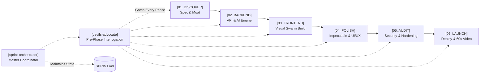

<p align="center">
  
</p>

<p align="center">
  
</p>

<p align="center">
  <a href="#pipeline"></a>
  <a href="#time-budget"></a>
  <a href="#toolchain"></a>
  <a href="LICENSE"></a>
</p>

---

## [SYSTEM OVERVIEW]

Developers and hackathon teams frequently have dozens of cutting-edge AI skills, plugins, and MCP servers available. During a competitive hackathon, tool execution often fractures into chaotic, ad-hoc prompting. Context windows overflow, verification passes get skipped, and prototypes end with unstyled interfaces or live runtime crashes during judging.

**Sprint System** enforces a disciplined, phase-based agentic operating system that orchestrates **21 plugins, 10 MCP servers, and 25 skills** into an automated pipeline designed to achieve a production-ready, judge-ready submission within **5 hours of prompting (1 day of work)**.

```
Problem Statement -> 6 Gated Phases (with Pre-Phase Interrogation) -> Judge-Ready Submission
```

---

## [PIPELINE]

<p align="center">
  
</p>



---

## [PRE-PHASE INTERROGATION GATE]

Before any sprint phase begins, the system enforces a mandatory two-step gate powered by `devils-advocate`:

1. **Executive Scorecard of Previous Phase**:
   - Elapsed sprint time vs 5-hour target budget.
   - Quantified deliverables (passing test suites, active endpoints, verified UI components).
   - Direct clickable links to generated artifacts (`docs/SPEC.md`, `PRODUCT.md`, schemas, visual snapshots).
   - Outstanding technical debt and carried risks.

2. **Strict Interactive Interrogation (15-Point Matrix)**:
   - Halts execution until the user provides explicit answers and direction.
   - Probes 5 critical dimensions:
     - **The Winning Moat** (Q01-Q03): Preventing generic ChatGPT-style slop.
     - **Custom Feature Wishlist** (Q04-Q06): Demanding user-specified killer features and signature moments.
     - **Technical Architecture** (Q07-Q09): State synchronization, query bottlenecks, and error fallbacks.
     - **Component Hierarchy & UX Microcopy** (Q10-Q12): Visual rhythm, scanability, and empathetic error messaging.
     - **Live Demo Failure Modes** (Q13-Q15): Pre-mortem analysis stress-testing judge scrutiny and offline failure.

---

## [PHASE SPECIFICATIONS]

### `[PHASE 01: DISCOVER]` (Target: ~30 min)
* **Pre-Phase Gate**: `devils-advocate` probes problem statement validity, persona, and technical moat.
* **Objective**: Technical scoping, competitor benchmarking, competitive moat definition, API contract, and relational schema.
* **Active Tooling**: `research` subagent, `impeccable` (init / shape), `api-anything` MCP & skill, `context7`, `api-design-principles`, `mermaid-expert`, `mobbin` MCP, `StitchMCP`, `graphify`.
* **Output**: `PRODUCT.md`, `docs/SPEC.md`, OpenAPI schema, relational ERD.

### `[PHASE 02: BACKEND]` (Target: ~60 min)
* **Pre-Phase Gate**: Phase 1 Scorecard + `devils-advocate` probes concurrency, data persistence, and API schemas.
* **Objective**: Core engine implementation, database persistence, Gemini LLM/RAG pipelines, un-APId live web data ingestion, and endpoint verification.
* **Active Tooling**: `fastapi-pro`, `gemini-api`, `rag-implementation`, `prompt-engineering-patterns`, `api-anything` MCP, `sqlite` MCP, `fetch` MCP, `docker` MCP, `postman`.
* **Output**: Operational async FastAPI backend with populated database and passing pytest suite.

### `[PHASE 03: FRONTEND]` (Target: ~75 min)
* **Pre-Phase Gate**: Phase 2 Scorecard + `devils-advocate` probes component hierarchy, state sync, and killer interactions.
* **Objective**: Component assembly and state binding using a visible multi-agent parallel swarm with Hot Module Replacement and Impeccable craft-floor rules.
* **Active Tooling**: `live-swarm-coding` (`resources/swarm-overlay.js`), `impeccable` (craft-floor & live variants), `react-state-management`, `react-modernization`, `browser-code-verifier`, `chrome-devtools-plugin`, `StitchMCP`.
* **Output**: Live interactive UI connected to backend endpoints with zero generic purple gradients.

### `[PHASE 04: POLISH]` (Target: ~45 min)
* **Pre-Phase Gate**: Phase 3 Scorecard + `devils-advocate` probes design compromises, bland layouts, and typography.
* **Objective**: Elevating the interface with design intelligence, typography scales, zero generic AI slop, and responsive fluidity.
* **Active Tooling**: `impeccable` (`/impeccable polish`, `/impeccable critique`, `/impeccable bolder`, `npx impeccable detect`), `ui-ux-pro-max`, `tailwind-design-system`, `ui-visual-validator`, `indian-gov-ui-skills` (if public/bilingual/gov).
* **Output**: High-contrast OLED Dark or Glassmorphic visual presentation with zero layout shifts and zero AI slop.

### `[PHASE 05: AUDIT]` (Target: ~45 min)
* **Pre-Phase Gate**: Phase 4 Scorecard + `devils-advocate` probes attack vectors, auth scopes, and crash recovery.
* **Objective**: DevSecOps security scanning, edge-case UI hardening, automated Playwright headless tests, telemetry, and zero console error verification.
* **Active Tooling**: `security-auditor`, `impeccable` (harden / audit), `coderabbit`, `sentry`, `playwright` MCP, `api-anything` MCP, `chrome-devtools-plugin`, `e2e-testing-patterns`.
* **Output**: `docs/AUDIT_REPORT.md` with verified security clean bill and zero runtime errors.

### `[PHASE 06: LAUNCH]` (Target: ~45 min)
* **Pre-Phase Gate**: Phase 5 Scorecard + `devils-advocate` probes deployment latency, judge friction, and video narrative.
* **Objective**: Live production deployment, 60-second Hyperframes launch video, interactive Swagger documentation, and judge-facing pitch documentation.
* **Active Tooling**: `brag` (Hyperframes video engine), `vercel-plugin`, `railway`, `firebase`, `openapi-spec-generation`, `git-advanced-workflows`.
* **Output**: Live deployed production URL, 60s demo pitch video, and comprehensive `README.md`.

---

## [TOOLCHAIN MASTER MATRIX]

```mermaid
flowchart TD
    subgraph P1 ["[01. DISCOVER & SPEC]"]
        t1["Gate: devils-advocate<br/>Plugins: superpowers, context7, google-developer-knowledge, gdocs<br/>MCPs: mobbin, StitchMCP, github-mcp-server, graphify, api-anything<br/>Skills: impeccable (init/shape), api-anything, api-design-principles, mermaid-expert, openapi-spec-generation"]
    end

    subgraph P2 ["[02. BACKEND, AI & DATA]"]
        t2["Gate: devils-advocate<br/>Plugins: gemini-api, google-antigravity-sdk, data-agent-kit, firebase, postman, google_maps<br/>MCPs: sqlite, fetch, docker, firebase-mcp-server, api-anything<br/>Skills: fastapi-pro, rag-implementation, prompt-engineering, api-anything, async-python, sql-optimization, python-testing, uv"]
    end

    subgraph P3 ["[03. FRONTEND VISUAL SWARM]"]
        t3["Gate: devils-advocate<br/>Plugins: browser-code-verifier, chrome-devtools, android-cli, flutter, modern-web-guidance<br/>MCPs: StitchMCP<br/>Skills: live-swarm-coding, impeccable (craft-floor/live), react-state-management, react-modernization, mobile-developer"]
    end

    subgraph P4 ["[04. BEAUTIFICATION & POLISH]"]
        t4["Gate: devils-advocate<br/>Plugins: modern-web-guidance, indian-gov-ui-skills (GIGW/UX4G)<br/>MCPs: mobbin, StitchMCP<br/>Skills: impeccable (polish/critique/bolder/detect), ui-ux-pro-max, tailwind-design-system, ui-visual-validator"]
    end

    subgraph P5 ["[05. DEVSECOPS & QA AUDIT]"]
        t5["Gate: devils-advocate<br/>Plugins: coderabbit, sentry, chrome-devtools, indian-gov-ui-skills (WCAG)<br/>MCPs: playwright, graphify, api-anything<br/>Skills: security-auditor, impeccable (harden/audit), e2e-testing-patterns, superpowers (debug)"]
    end

    subgraph P6 ["[06. PRODUCTION LAUNCH]"]
        t6["Gate: devils-advocate<br/>Plugins: brag (video), vercel-plugin, railway, firebase, postman, gdocs<br/>MCPs: github-mcp-server<br/>Skills: brag, openapi-spec-generation, git-advanced-workflows, mermaid-expert"]
    end

    P1 --> P2 --> P3 --> P4 --> P5 --> P6
```



---

## [VISUAL SWARM ENGINE]

The system bundles a self-contained visual overlay engine (`skills/live-swarm-coding/resources/swarm-overlay.js`) that renders real-time agent presence directly inside the browser during development:

```
[Agent Orion]  -> Purple (#A855F7) -> Layout, Flexbox, & Grid Hierarchy
[Agent Lyra]   -> Emerald (#10B981) -> Design Tokens, Colors, & Tailwind Gradients
[Agent Echo]   -> Amber (#F59E0B)  -> Reactive State, Event Listeners, & Handlers
[Agent Nova]   -> Sky (#0EA5E9)    -> Real-Time WCAG A11y & Contrast Validator
```

* **Dashed Selection Boxes**: Outline frames snap around DOM nodes actively being edited.
* **Code Streamer Pills**: Real-time syntax-highlighted badges display modifications as they occur.
* **Glassmorphic Dock**: Bottom control bar tracking HMR latency, pause toggles, and speed dials.

---

## [QUICKSTART]

### Installation in Google Antigravity

```powershell
# Clone the repository
git clone https://github.com/VihaanR/sprint-system.git

# Copy skills to your global Antigravity discovery path
Copy-Item -Path "sprint-system\skills\*" -Destination "$HOME\.gemini\config\skills\" -Recurse -Force
```

### Installation in Claude Code / Cursor / Codex

```bash
# Copy skills into cross-agent directory
cp -r sprint-system/skills/* ~/.agents/skills/
```

### Starting a Sprint

Initiate any new project or hackathon prompt:
> **"Start sprint for [Project Name / Problem Statement]"**

The orchestrator initializes `SPRINT.md`, maintains time budgets, executes subagents autonomously within each phase, and halts before each phase to deliver the **Executive Scorecard** and conduct the **Devil's Advocate 15-Point Interrogation**.

---

## [CHECKPOINT WORKFLOW]

Every project maintains a root `SPRINT.md` checkpoint ledger:

1. **Pre-Phase Gate**: Scorecard delivered + Devil's Advocate interrogation answered.
2. **Autonomous Execution**: Subagents execute the current phase tasks.
3. **Phase Completion**: Quantified deliverables updated in `SPRINT.md`.
4. **Transition**: System presents next phase scorecard and triggers next interrogation.

---

## [LICENSE]

MIT License. Designed for hackathon competitors, builders, and autonomous engineering workflows.
