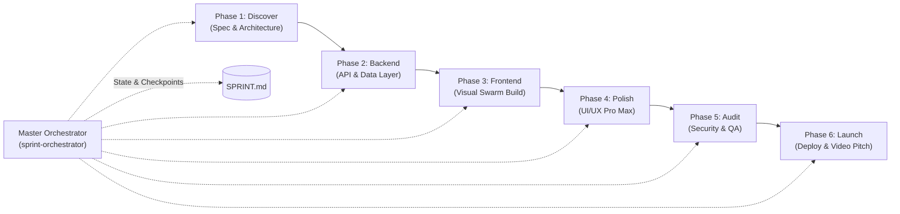

# Implementation Plan: Global Hackathon-Winning 5-Hour Agentic Operating System

## Goal Description
To eliminate decision fatigue and fragmented tool usage, we are creating a structured **6-Phase Hackathon Sprint Engine** (inspired by `affaan-m/ecc` and top-tier global hackathon winners) accompanied by a **Master Sprint Orchestrator**. 

This system guides an agent from problem statement to a production-ready, judge-ready submission within **5 hours of prompting (1 day of work)**. It automatically activates the right skills, MCP servers, and subagents at each phase, tracks progress in a `SPRINT.md` checkpoint file, and enforces fast-gated autonomy (autonomous execution with 1-click user gate approvals).

---

## User Decisions & System Specifications

* **Lifecycle Structure**: 6 Combined Phases (Discover $\rightarrow$ Core Backend $\rightarrow$ Visual Frontend Swarm $\rightarrow$ UI/UX Polish $\rightarrow$ Security & QA Audit $\rightarrow$ Judge-Ready Launch).
* **Invocation Model**: Hybrid architecture (6 standalone phase skills + 1 master `sprint-orchestrator` skill).
* **Autonomy Model**: Fast-Gated Autonomy (subagents execute phase tasks autonomously $\rightarrow$ updates `SPRINT.md` $\rightarrow$ pauses for user 1-click approval).
* **Deliverable Standard**: Global Hackathon Winning Grade (Live deployed URL + 60s `brag` video + Mermaid architecture README + interactive Swagger API docs + zero console errors).

---

## Phase Pipeline Architecture



---

## Proposed Changes

### Component 1: Master Sprint Orchestrator (`sprint-orchestrator`)

#### [NEW] `C:\Users\Vihaan\.gemini\config\skills\sprint-orchestrator\SKILL.md`
* **Purpose**: Coordinates the entire hackathon sprint lifecycle. Maintains `SPRINT.md` in the project root, tracks phase timers (aiming for $\le 5$ hours), handles "start sprint", "next phase", "sprint status", and invokes phase subagents.

---

### Component 2: Phase 1 — Discover & Spec (`phase-discover`)

#### [NEW] `C:\Users\Vihaan\.gemini\config\skills\phase-discover\SKILL.md`
* **Time Budget**: ~30 minutes
* **Active Tooling**: `research` subagent, `context7`, `api-design-principles`, `mermaid-expert`, `graphify`.
* **Execution**:
  1. Breaks down problem statement & targets hackathon judging rubric (Innovation, Technical Depth, Usability).
  2. Identifies the "Winning Hook" / Moat against competitor systems.
  3. Formulates database ERD and OpenAPI contract.
* **Output**: `docs/SPEC.md` + system architecture diagrams.

---

### Component 3: Phase 2 — Core Engine & Backend (`phase-backend`)

#### [NEW] `C:\Users\Vihaan\.gemini\config\skills\phase-backend\SKILL.md`
* **Time Budget**: ~60 minutes
* **Active Tooling**: `fastapi-pro`, `sqlite` MCP, `fetch` MCP, `docker` MCP, `python-testing-patterns`, `test-driven-development`.
* **Execution**:
  1. Scaffolds async FastAPI service with SQLAlchemy 2.0 and Pydantic V2 models.
  2. Seeds initial mock/test data into SQLite (`chatbot.db` or project db).
  3. Implements authentication, routes, and business logic with TDD unit tests.
  4. Verifies live response payloads using `fetch` MCP.
* **Output**: Running, test-passing backend with operational database.

---

### Component 4: Phase 3 — Visual Swarm & Frontend Build (`phase-frontend`)

#### [NEW] `C:\Users\Vihaan\.gemini\config\skills\phase-frontend\SKILL.md`
* **Time Budget**: ~75 minutes
* **Active Tooling**: `live-swarm-coding` (`swarm-overlay.js`), `react-state-management`, `react-modernization`, `StitchMCP`, `browser-code-verifier`.
* **Execution**:
  1. Starts local Vite dev server with Hot Module Replacement (HMR).
  2. Mounts the visual Swarm HUD overlay.
  3. Dispatches parallel subagents (Orion for Layout, Lyra for Colors, Echo for State) while Chrome DevTools stays open so the user watches the UI build in real-time.
  4. Connects UI components to live backend endpoints.
* **Output**: Fully functional, hot-reloaded frontend application.

---

### Component 5: Phase 4 — Beautification & Polish (`phase-polish`)

#### [NEW] `C:\Users\Vihaan\.gemini\config\skills\phase-polish\SKILL.md`
* **Time Budget**: ~45 minutes
* **Active Tooling**: `ui-ux-pro-max`, `tailwind-design-system`, `ui-visual-validator`.
* **Execution**:
  1. Queries local UI/UX Pro Max intelligence (`search.py`) for OLED Dark, Glassmorphism, or Bento styles.
  2. Injects cohesive typography scales and semantic color tokens.
  3. Replaces placeholder text with contextual microcopy and Phosphor/Lucide SVG icons.
  4. Adds smooth CSS micro-interactions and eliminates layout shifts (CLS $< 0.1$).
* **Output**: "Awwwards-grade" visual presentation guaranteed to stand out to judges.

---

### Component 6: Phase 5 — Ironclad Audit & Verification (`phase-audit`)

#### [NEW] `C:\Users\Vihaan\.gemini\config\skills\phase-audit\SKILL.md`
* **Time Budget**: ~45 minutes
* **Active Tooling**: `security-auditor`, `coderabbit` (`code-reviewer`), `chrome-devtools-plugin`, `playwright` MCP, `e2e-testing-patterns`.
* **Execution**:
  1. Scans for OWASP vulnerabilities (SQLi, auth bypass, secret leaks in Git).
  2. Runs Playwright headless smoke tests on critical user journeys.
  3. Validates zero runtime errors/red flags in the browser console.
  4. Verifies WCAG accessibility and keyboard navigation.
* **Output**: `docs/AUDIT_REPORT.md` with verified security and QA pass.

---

### Component 7: Phase 6 — Judge-Ready Pitch & Launch (`phase-launch`)

#### [NEW] `C:\Users\Vihaan\.gemini\config\skills\phase-launch\SKILL.md`
* **Time Budget**: ~45 minutes
* **Active Tooling**: `brag` (Hyperframes launch video generator), `openapi-spec-generation` (Swagger docs), `vercel-plugin` / `railway` (deployments), `git-advanced-workflows` (clean release).
* **Execution**:
  1. Deploys frontend to Vercel and backend to Railway/Docker.
  2. Compiles a 60-second product launch video via `brag`.
  3. Generates the winning `README.md` (Elevator pitch, Problem/Solution, Architecture diagram, Judge testing credentials, Live URL).
  4. Tags the repository with clean release commits.
* **Output**: Live deployed URL + 60s video + killer README submission pack.

---

## Mirroring to Cross-Agent Directory

All 7 created skills will be mirrored to `C:\Users\Vihaan\.agents\skills/` to ensure cross-agent availability.

---

## Verification Plan

### Automated Verification
1. Verify all 7 skill folders and `SKILL.md` files exist and have valid YAML frontmatter:
   ```powershell
   Get-ChildItem "C:\Users\Vihaan\.gemini\config\skills\sprint-*", "C:\Users\Vihaan\.gemini\config\skills\phase-*" | Select-Object Name
   ```
2. Verify test-run of `sprint-orchestrator` status command.

### Manual Verification
1. Test triggering `sprint-orchestrator` on a sample project to ensure `SPRINT.md` is initialized and gating works properly.
