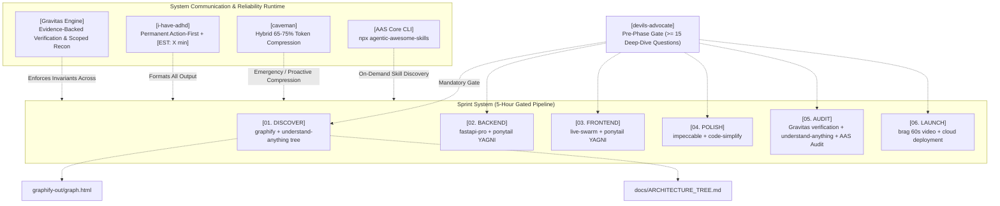

# [PLAN] Candidate Repositories & Reliability Architecture Integration

This document provides the finalized architectural blueprint and implementation plan for integrating **Gravitas** along with the previous 6 candidate repositories into the **Sprint System** hackathon operating system, while enforcing a mandatory **>= 15 deep-dive questions** protocol for the pre-phase interrogation gate.

---

## [FINAL ALIGNED TRIAGE MATRIX (7 REPOSITORIES)]

| Repository | Focus Domain | Architectural Verdict | Pipeline Placement | Execution Mechanism & Output |
| :--- | :--- | :--- | :--- | :--- |
| **`Gravitas`** (Uday Sharma) | Engineering Reliability Kernel | **[ADOPT]** Overarching Reliability Policy | All Phases (1-6) & Gate Invariants | "Report what actually happened, not what you intended." Enforces scoped reconnaissance, evidence-backed verification, and mechanical proofs. |
| **`ponytail`** | YAGNI & Anti-Overengineering | **[ADOPT]** Core Skill & Rule | Phase 2 (Backend), Phase 3 (Frontend), Phase 5 (Audit) | Active YAGNI checks during code generation; `/ponytail-review` negative-LOC audit in Phase 5. |
| **`agent-skills`** (Addy Osmani) | Code Quality & Verification | **[CHERRY-PICK]** Top 2 Engines | Phase 4 (Polish), Phase 5 (Audit), `devils-advocate` | `/code-simplify` reduces complexity in Phase 4; anti-rationalization matrix halts excuses in Phase 5 & gates. |
| **`i-have-adhd`** | High-Density Action Protocol | **[ADAPT]** Permanent Communication Standard | Global Pipeline & `sprint-orchestrator` | Permanent default formatting: Line 1 executable action, `[EST: X min]` bounds, zero conversational filler. |
| **`Understand-Anything`** | AST Architecture Tree & Tour | **[ADOPT]** Post-Graphify Drill-down | Phase 1 (Discover), Phase 5 (Audit) | Runs immediately after Graphify to generate `docs/ARCHITECTURE_TREE.md` + optional `npx understand-anything-viewer`. |
| **`agentic-awesome-skills`** | Mega-Catalog & AAS Core | **[ADOPT & BUNDLE]** AAS Core + Elite Bundle | Toolchain Runtime & `skills/aas/` | `npx agentic-awesome-skills` CLI for on-demand discovery + 4 cherry-picked elite skills (Security, Chaos, Benchmark, Leak). |
| **`caveman`** | Extreme Token Compression | **[ADOPT]** Hybrid Compression Engine | Standalone Skill & Sprint Monitor | Manual `/caveman [tier]` command + proactive automatic recommendation when tokens/turns exceed 70%. |

---

## [CORE ARCHITECTURAL ENHANCEMENTS]

### 1. `Gravitas` Engineering Reliability Runtime
- **Repository**: `https://github.com/udaysharmadev/Gravitas`
- **Core Philosophy**: *"Report what actually happened, not what you intended. When you claim something is done, fixed, or verified, that claim must rest on observed, mechanical tool output."*
- **Four Core Invariants Enforced Across All Phases**:
  1. **Scoped Reconnaissance**: The agent is strictly prohibited from modifying files without inspecting them first or dumping unread files into context.
  2. **Adaptive Planning**: Mechanical preconditions must be verified before executing state-changing tools.
  3. **Evidence-Backed Verification**: No phase transition or task completion claim is accepted without quoting actual command exits, test pass counts, or DOM snapshot evidence.
  4. **Failure Recovery**: Looping identical failing tool calls is banned; agent must isolate root causes and pivot strategy.
- **Skill Placement**:
  - `skills/gravitas/SKILL.md` (and global mirror in `C:\Users\Vihaan\.gemini\config\skills\gravitas\SKILL.md`).
  - Active policy rules injected into `sprint-orchestrator` and `phase-audit`.

---

### 2. Mandatory `>= 15 Deep-Dive Questions` Pre-Phase Gate
- **Problem Identified**: In previous sessions, agents compressed the 15-Point Matrix into 3-4 broad summary questions to save output tokens, losing critical feature extraction and failure analysis.
- **Strict Protocol Enforcement**:
  - **Hard Minimum**: Every pre-phase gate MUST ask **>= 15 distinct, granular questions** across all 5 dimensions.
  - **No Collapsing Allowed**: It is strictly forbidden to batch or summarize the 15 questions into high-level summaries.
  - **Distribution**:
    - **Dimension 1: The Winning Moat & Anti-Slop** (Questions 01-03)
    - **Dimension 2: Custom Feature Wishlist & Signature Moments** (Questions 04-06)
    - **Dimension 3: Technical Architecture & State Integrity** (Questions 07-09)
    - **Dimension 4: Component Hierarchy & UX Microcopy** (Questions 10-12)
    - **Dimension 5: Live Demo Failure Modes & Judge Scrutiny** (Questions 13-15)
  - **Antigravity Interactive Mechanism**:
    - Questions are presented with concrete, opinionated `(Recommended)` options alongside high-risk alternatives.
    - Execution remains paused until the user completes the 15-point interrogation.

---

### 3. `Understand-Anything` Post-Graphify Integration
- **Execution**: Chained immediately following `graphify` in Phase 1 (Discover) and Phase 5 (Audit).
- **Deliverable**: Produces `docs/ARCHITECTURE_TREE.md` detailing:
  - Macro architectural tiers (presentation, application logic, data persistence).
  - Business domain boundaries and dependency hierarchies.
  - Complexity hotspots and circular references.
- **Interactive UI**: Offers launch command:
  ```bash
  npx https://github.com/Egonex-AI/Understand-Anything/releases/latest/download/understand-anything-viewer.tgz .
  ```

---

### 4. `agentic-awesome-skills` (AAS Core + Elite 4-Skill Bundle)
- **AAS Core CLI**: Integrated into `requirements.txt` via `npx agentic-awesome-skills` for runtime discovery.
- **Curated Elite 4-Skill Bundle in `skills/aas/`**:
  - `skills/aas/security-hardening.md`: OWASP defenses, input sanitization, timing attacks.
  - `skills/aas/chaos-testing.md`: Latency injection, simulated service failures.
  - `skills/aas/micro-benchmark.md`: Microsecond inner-loop and serializer profiling.
  - `skills/aas/memory-leak-hunter.md`: Heap growth, unclosed streams, and dangling listeners.

---

### 5. `i-have-adhd` Permanent Sprint Communication Protocol
- Permanent default format across all sprint turns:
  1. **Line 1 Action**: The first line is always the next immediate executable command or technical action.
  2. **Minute Bounds**: Every planned action carries an explicit minute estimate (`[EST: X min]`).
  3. **Visual Monospace Tags**: `[ACTION]`, `[VERIFY]`, `[DONE]`, `[BLOCKED]`, `[EST: X min]`.
  4. **Zero Conversational Padding**: No conversational greetings, throat-clearing, or sign-offs.

---

### 6. `juliusbrussee/caveman` Hybrid Token Saver
- Slash commands: `/caveman lite`, `/caveman full`, `/caveman ultra`, `/caveman off`.
- Proactive escalation: `sprint-orchestrator` monitors context consumption; recommends activation when session tokens exceed 70%.

---

### 7. Two-Stage Ponytail YAGNI & Addy Osmani `code-simplify` Pipeline
- **Stage 1 (Phase 2 & 3 Generation)**: Ponytail YAGNI active (concrete code first, no speculative abstractions, no unrequested wrappers).
- **Stage 2 (Phase 4 & 5 Hardening)**: `/code-simplify` complexity reduction + Ponytail negative-LOC audit + Addy Osmani Anti-Rationalization verification.

---

## [TARGET PIPELINE ARCHITECTURE]



---

## [STEP-BY-STEP IMPLEMENTATION PLAN]

### Step 1: Implement `gravitas` Reliability Runtime
- Path: `skills/gravitas/SKILL.md` (and mirrored to `C:\Users\Vihaan\.gemini\config\skills\gravitas\SKILL.md`).
- Policy instructions: Scoped reconnaissance, adaptive planning, evidence-backed verification, and failure recovery.

### Step 2: Implement `ponytail` Anti-Overengineering Engine
- Path: `skills/ponytail/SKILL.md` (and global mirror).
- YAGNI heuristics, negative LOC review workflow (`/ponytail-review`), anti-abstraction rules.

### Step 3: Ingest Addy Osmani's `code-simplify` & Anti-Rationalization Matrix
- Path: `skills/code-simplify/SKILL.md` (and global mirror).
- Cyclomatic complexity reduction, conditional flattening, anti-rationalization table embedded in `devils-advocate` and `phase-audit`.

### Step 4: Implement `understand-anything` Post-Graphify Engine
- Path: `skills/understand-anything/SKILL.md` (and global mirror).
- Workflow for generating `docs/ARCHITECTURE_TREE.md` immediately following Graphify in Phase 1 & 5.

### Step 5: Implement `caveman` Token Compression Protocol
- Path: `skills/caveman/SKILL.md` (and global mirror).
- 3 tiers (`lite`, `full`, `ultra`) and slash command handler.

### Step 6: Package Curated Elite 4-Skill AAS Bundle
- Path: `skills/aas/` containing:
  - `security-hardening.md`
  - `chaos-testing.md`
  - `micro-benchmark.md`
  - `memory-leak-hunter.md`

### Step 7: Update `devils-advocate` for Mandatory `>= 15 Deep-Dive Questions`
- Path: [`skills/devils-advocate/SKILL.md`](file:///C:/Users/Vihaan/.gemini/antigravity/scratch/sprint-system/skills/devils-advocate/SKILL.md) (and global mirror).
- Remove batching/collapsing clauses; mandate asking all 15 detailed questions in full across the 5 dimensions before any phase begins.

### Step 8: Update Master Pipeline Orchestrator & Phases
- Update [`skills/sprint-orchestrator/SKILL.md`](file:///C:/Users/Vihaan/.gemini/antigravity/scratch/sprint-system/skills/sprint-orchestrator/SKILL.md):
  - Integrate Gravitas invariants.
  - Wire permanent `i-have-adhd` format.
  - Wire proactive Caveman token monitoring.
  - Chain `understand-anything` after `graphify` in Phase 1 & 5.
  - Enforce Ponytail in Phase 2/3 and `code-simplify` in Phase 4/5.
- Update `phase-discover`, `phase-backend`, `phase-frontend`, `phase-polish`, `phase-audit`, `phase-launch`.

### Step 9: Update Toolchain Specifications & Documentation
- Update [`requirements.txt`](file:///C:/Users/Vihaan/.gemini/antigravity/scratch/sprint-system/requirements.txt):
  - Register Gravitas, AAS Core CLI, and Understand-Anything.
- Update [`README.md`](file:///C:/Users/Vihaan/.gemini/antigravity/scratch/sprint-system/README.md):
  - Add Gravitas reliability invariants.
  - Document the `>= 15 questions` interrogation rule.
  - Document `/ponytail-review`, `/code-simplify`, `/caveman`, and `understand-anything`.

### Step 10: Strict Character Audit & GitHub Push
- Audit all files to verify zero standard emojis and zero em-dashes.
- Stage, commit, and push changes to `origin/main`.

---

> [!IMPORTANT]
> **Headroom & Prompt Health Check**:
> - Total persistent global skills added: 5 (`gravitas`, `ponytail`, `code-simplify`, `understand-anything`, `caveman`).
> - AAS skills housed in modular subfolder `skills/aas/`.
> - Total global skills: 30 skills (under the safe threshold of 35).
> - Every phase is locked behind Gravitas evidence verification and Devil's Advocate 15-question interrogation.

---

## [FEEDBACK & CONFIRMATION]

Please review this comprehensive plan incorporating **Gravitas** and the **>= 15 deep-dive questions** mandate. Once confirmed, I will immediately begin implementation across all files.
