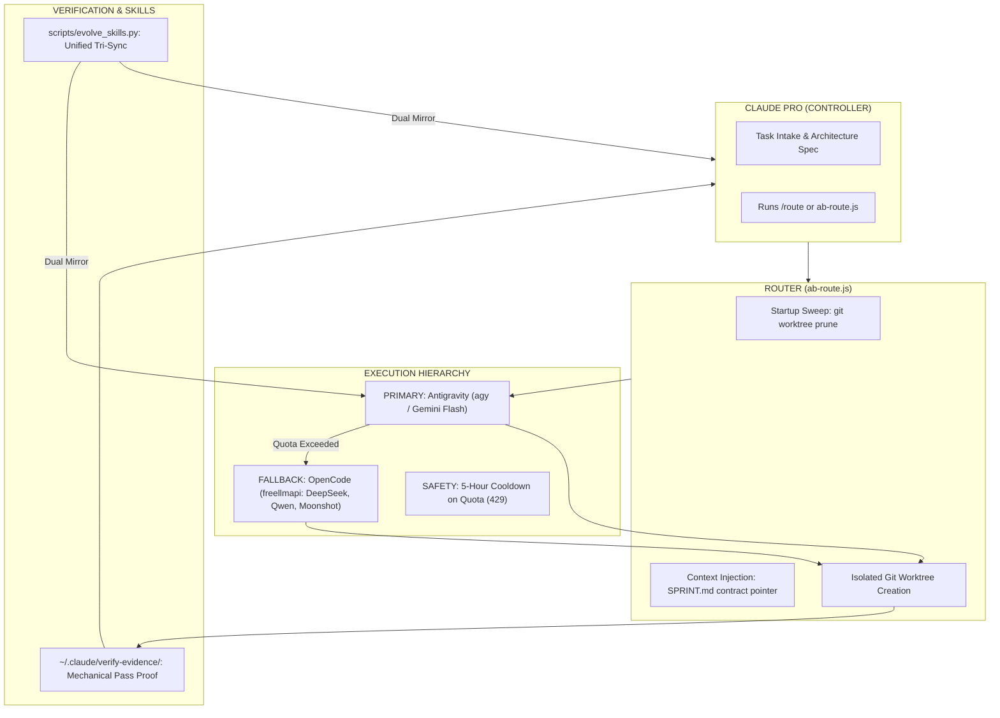

# Implementation Plan: Claude Code & Antigravity Orchestrator Upgrade v2.0

Upgrade and harmonize the Claude Code orchestrator (`ab-route.js`), routing guard (`route-guard.js`), and Sprint System v2.0 skills across both Google Antigravity and Claude Pro environments.

---

## [Goal Description]

The developer uses **Claude Pro (Sonnet)** as the master architect and reviewer, and delegates mechanical implementation to **Antigravity (`agy` / Gemini)** and **OpenCode (`freellmapi`)**. 

Following the `/grill-me` alignment:
1. **Antigravity (`agy`) is the PRIMARY high-velocity executor** for `--class large` and code generation, leveraging Gemini's speed and large context window via the official CLI.
2. **OpenCode (`freellmapi`: Moonshot K2.7, Qwen3-Coder, DeepSeek v4.1 Flash)** serves as the automated fallback fleet whenever Antigravity reaches standard 429 quota cooldowns.
3. **Unified Tri-Sync**: `scripts/evolve_skills.py` will automatically synchronize updated Sprint System v2.0 skills to both `~/.gemini/config/skills/` and `~/.claude/skills/`.
4. **Windows Worktree Hardening**: Eliminate `EBUSY`/`EPERM` file-lock errors during git worktree removal with startup prune sweeps and retry backoff.
5. **Contract Context Injection**: Automatically inject `SPRINT.md` and `types.ts` contract pointers into worker prompts so executors never hallucinate project patterns.

---

## User Review Required

> [!IMPORTANT]
> **Antigravity Terms of Service Clarification**: Calling `agy` via `agent-bridge` invokes your locally authenticated official Antigravity CLI binary with standard developer prompts. This does not violate Google Terms of Service. Normal 429 quota cooldowns (5 hours) remain active in `ab-route.js` to prevent retry loops.

> [!NOTE]
> **Worktree Safety**: All write actions remain strictly isolated in `~/.agent-bridge/worktrees/`. Neither Antigravity nor OpenCode can write directly to your active repository branch, commit, push to GitHub, or open pull requests.

---

## Ponytail Ruthless YAGNI Audit

| Invariant | Evaluation | Verdict |
| :--- | :--- | :--- |
| **01: Rule of Concrete Implementation** | Patches existing concrete scripts (`ab-route.js`, `evolve_skills.py`). Zero new abstract wrappers or daemons. | **PASS** |
| **02: Negative LOC is a Victory** | Avoids creating separate sync scripts or configuration parsers; inlines tri-sync in ~8 lines. | **PASS** |
| **05: Hardcoded Sensible Defaults** | Keeps timeouts and cooldowns hardcoded in `COOLDOWN_MIN` rather than introducing dynamic config files. | **PASS** |
| **08: Zero Dead & Speculative Code** | Removes parked dead branches and wires active models directly. | **PASS** |

---

## Proposed Changes



---

### Component 1: Skill Synchronization (`sprint-system`)

#### [MODIFY] `scripts/evolve_skills.py`
Add `CLAUDE_SKILLS_DIR = os.path.expanduser("~/.claude/skills")` and mirror all verified skills to both directories during the evolution cycle:

```python
    # Dual-Sync to global Antigravity & Claude Code
    print("[ACTION] Dual-syncing verified skills to ~/.gemini/config/skills/ and ~/.claude/skills/...")
    target_skills = [
        "sprint-orchestrator", "phase-discover", "phase-backend",
        "phase-frontend", "phase-polish", "phase-audit", "phase-launch",
        "sprint-recursive-optimizer"
    ]
    for s in target_skills:
        src = os.path.join(SKILLS_DIR, s, "SKILL.md")
        if os.path.exists(src):
            with open(src, "r", encoding="utf-8") as sf:
                content = sf.read()
            for base_dir in [GLOBAL_SKILLS_DIR, os.path.expanduser("~/.claude/skills")]:
                dest_dir = os.path.join(base_dir, s)
                os.makedirs(dest_dir, exist_ok=True)
                with open(os.path.join(dest_dir, "SKILL.md"), "w", encoding="utf-8") as df:
                    df.write(content)
            print(f"[SYNCED] {s} -> Antigravity & Claude")
```

---

### Component 2: Claude Router Engine (`~/.claude/bin/ab-route.js`)

#### [MODIFY] `~/.claude/bin/ab-route.js`
1. **Startup Prune Sweep**: Run `git(o.repo, "worktree", "prune")` upon initialization to release stale file locks from crashed or closed sessions.
2. **Worktree Removal Resilience**: Add retry backoff (3 attempts with 300ms delays) in `removeTree()` to cleanly wait for Windows file handles (`python.exe`, `node.exe`) to close before unlinking.
3. **Execution Chain Priority**: Ensure `CHAINS.large` explicitly prioritizes Antigravity first, with OpenCode freellmapi models as robust fallbacks:
   ```javascript
   large: [
     ["antigravity", {}],
     ["opencode:free", { agent: "worker" }],
     ["opencode:free", { agent: "worker", model: FREE_ALT }],
     ["opencode:free", { agent: "worker", model: FREE_ZR }]
   ],
   ```
4. **Context Contract Pointer**: Before spawning child processes, check if `SPRINT.md` exists in `cwd` or `o.repo`. If found, prepend:
   `[CONTEXT CONTRACT: Read SPRINT.md before editing code. Preserve existing schemas and architectural patterns.]\n\n` to the worker prompt.

---

### Component 3: Claude Instruction Alignment (`~/.claude/CLAUDE.md`)

#### [MODIFY] `~/.claude/CLAUDE.md`
Verify that `CLAUDE.md` documents:
- Antigravity as the primary code generation workhorse.
- OpenCode freellmapi as the quota-exhaustion fallback.
- Claude Pro keeping architectural ownership and diff sign-off.

---

## Verification Plan

### Automated Tests
1. **Run Unified Tri-Sync Validation**:
   ```bash
   python "C:\Users\Vihaan\.gemini\antigravity\scratch\sprint-system\scripts\evolve_skills.py"
   ```
   *Expected:* Exit Code 0, 21 skills validated, all 8 phase skills synced to both `~/.gemini/config/skills` and `~/.claude/skills`.

2. **Verify Skill Size Parity**:
   ```bash
   python -c "import os; p1 = os.path.getsize(r'C:\Users\Vihaan\.gemini\config\skills\sprint-orchestrator\SKILL.md'); p2 = os.path.getsize(r'C:\Users\Vihaan\.claude\skills\sprint-orchestrator\SKILL.md'); print(f'Antigravity: {p1}b | Claude: {p2}b | Parity: {p1 == p2}')"
   ```
   *Expected:* `Parity: True`.

3. **Dry-Run Router Chain Verification**:
   ```bash
   node "C:\Users\Vihaan\.claude\bin\ab-route.js" --dry --class large "build sample component"
   ```
   *Expected:* Confirms `antigravity` is selected as the primary executor with `opencode:free` fallback.

### Manual Verification
- Launch Claude Code (`claude`) in any test repository.
- Verify that running `/route` or invoking `node ~/.claude/bin/ab-route.js --status` shows clean states with zero Windows lockup errors.
