# [PLAN: SPRINT SYSTEM v2.0 - THE 9-FACTION ARCHITECTURAL GRAND ACCORD]

## [Goal Description]
Synthesize and codify the definitive, hackathon-winning architecture for **Sprint System v2.0** following the multi-agent debate among all 9 Core Architectural Factions representing 320 installed skills, 30 plugins, and 10 MCP servers.

---

## The 9-Faction Architectural Grand Accord (Resolved Contradictions)

> [!IMPORTANT]
> **Key Reconciliations & Platform Invariants**:
>
> 1. **Contradiction: 15-Question Pre-Mortem vs. Sub-Minute Sprint Velocity**
>    - *Faction 2 (Adversarial Moat)* demanded a 15-question pre-mortem to prevent shallow ChatGPT wrappers.
>    - *Faction 1 (Ponytail)* attacked this as a 45-minute chat freeze.
>    - *Faction 3 (TRIZ) & Faction 4 (Chat SDK) Resolution*: 
>      - **Tier 1 (Automated Heuristics - 12 Questions)**: Auto-resolved in <2s via repository, MCP, and environment reconnaissance.
>      - **Tier 2 (Irreducible Strategic Choices - 3 Questions)**: Rendered as **one single interactive Generative UI / HTML5 card** (moat, target user, killer tactile demo). Developer answers in 45 seconds flat.
>      - **Async Shadow Threat Modeling**: Out-of-band subagent sidecar injects resilience tests directly into `SPRINT.md`.
>
> 2. **Contradiction: Anti-AI Slop Purism vs. Sleek Visual Delight**
>    - *Faction 8 (Anti-AI Slop Leader)* brutally condemned the 95% of hackathon apps built with purple-to-indigo gradients, floating sparkle badges, fake "99.9% accuracy" bento grids, and buzzword copy ("Seamlessly elevate your workflow").
>    - *Faction 9 (Sleek UI/UX Leader)* attacked raw YAGNI minimalists and joyless brutalists: an ACID-compliant backend trapped behind a clumsy, lifeless UI gets dismissed by judges in under 15 seconds.
>    - *The Slop-Free Sleek Synthesis*:
>      - **Death to AI Clichés**: Ban purple-indigo gradients, decorative non-functional sparkles, and generic SaaS templates.
>      - **Domain-Tailored Aesthetic**: Developer tools get crisp monochrome monospace; healthcare gets clinical slate and high-contrast tables; fintech gets dense data grids.
>      - **Tactile Spatial Depth**: Layered Z-axis elevation, calibrated glassmorphism (`backdrop-filter: blur(16px)`), sub-pixel border highlights (`1px solid rgba(255,255,255,0.08)`), and 3D perspective transforms (`perspective: 1000px`).
>      - **Pro Ergonomics**: Global command palette (`Cmd+K`), keyboard navigation, instant optimistic state updates (<16ms), active press response (`active:scale-[0.98]`).
>      - **The 12 Laws of Motion**: Non-linear deceleration (`cubic-bezier(0.25, 1, 0.5, 1)`), elastic settling (`cubic-bezier(0.34, 1.56, 0.64, 1)`), 50ms staggered cascade, GPU composited transforms only.
>      - **Authentic Notebook Sketch Dynamic (When Active)**: Warm cream paper (`#FCFBF7`), horizontal blue ruling lines, red margin guide, graphite pencil strokes (`#18181B`), and squash-and-stretch physics.
>
> 3. **Contradiction: Parallel Swarm Throughput vs. Shared Git State Collisions**
>    - *Faction 3 (TRIZ) & Faction 5 (Platform) Resolution*:
>      - **Minute-1 Immutable Kernel Contract**: Lock `types.ts` / Pydantic schema / OpenAPI contract before parallelizing.
>      - **Zero-Copy Shared Worktrees (`workspace: "share"`)**: Workers execute in isolated worktree working directories with independent indices over shared `.git` object storage.
>      - **Dynamic Feature Slice Registry**: Workers write self-contained slices (`features/<slice>/index.ts` or `routers/<slice>.py`). The host monolith imports slices via auto-discovery (`import.meta.glob`), completely eliminating write locks on central files.
>
> 4. **Contradiction: Negative LOC / Extreme YAGNI vs. Zero-Trust Security & Mechanical QA**
>    - *Faction 1 (Ponytail)* demanded deleting abstractions, boilerplate, and microservice wrappers.
>    - *Faction 6 (Security & QA)* warned that deleting auth middleware and rate limiting causes fatal security vulnerabilities.
>    - *Resolution*: Security is enforced via **out-of-band AST scans and pre-commit tooling** (`AgentShield`, `security-auditor`, `gitleaks`) and declarative rules (`firestore-rules-author`), rather than runtime wrapper bloat. Zero runtime performance penalty, zero LOC bloat in core business logic.
>
> 5. **Contradiction: Hackathon Prototype Theater vs. Real-World Commercial Moat**
>    - *Faction 7 (Cloud & Launch)* established the **Zero-Localhost Ironclad Rule**: Localhost is an instant disqualification.
>    - *Resolution*:
>      - Minute-1 instant edge deployment (Vercel OR Railway OR Netlify) returning HTTP 200 within 2 seconds.
>      - Live Stripe checkout test session (`/api/v1/billing/create-checkout-session` -> `cs_test_...`) proving immediate monetization viability.
>      - Programmatic 60-second video demo compiled directly via Remotion React code (`remotion-best-practices` + `brag`) with Spring physics (`cubic-bezier(0.25, 1, 0.5, 1)`).
>      - Domain grounding via deep-tech science tools (RDKit molecular descriptors, PDB macromolecular structures, Boltz-2 co-folding).
>
> 6. **Platform Memory Invariant: Active Context Pruning (ACP)**
>    - *Faction 5 (Platform)* enforces that raw compiler outputs, large pytest traces, and build logs are intercepted and flushed to disk (`docs/AUDIT_REPORT.md` / `scratch/`).
>    - Context memory is kept strictly below 35% utilization across the entire 5-hour sprint lifecycle.

---

## Sprint System v2.0 Architecture Flowchart

```mermaid
flowchart TD
    subgraph P1["PHASE 1: DISCOVER (~30m) - THE 45s INTERACTIVE GATE"]
        D1["devils-advocate + Pocock /grill-me (1 Card, 3 Strategic Choices)"]
        D2["Automated Heuristic Recon (12 Questions Auto-Resolved in <2s)"]
        D3["science (10 DBs: ChEMBL, PDB, ClinVar, PubMed...)"]
        D4["browse (Live Competitive Recon)"]
        D5["DEMO_MODE=offline (Resilient Cached Fixture Definition)"]
        D6["Single Living Artifact: SPRINT.md (Spec + Contract + Ticket Checklist)"]
    end

    subgraph P2["PHASE 2: BACKEND (~60m) - CONCRETE MONOLITH CORE"]
        B1["FastAPI Monolith + Gemini 2.0 Flash/Pro + RAG"]
        B2["Ponytail Rule: Concrete First (Zero Generic Repository Wrappers)"]
        B3["auth0 / firebase (Zero-Boilerplate Identity Layer)"]
        B4["firestore-rules-author (Declarative Security Rules Subagent)"]
        B5["stripe (Instant Checkout Session & Webhook Listener)"]
        B6["science (RDKit Descriptors & Boltz-2 Co-Folding API)"]
        B7["Minute-1 Immutable Kernel Contract (types.ts / OpenAPI / Pydantic)"]
    end

    subgraph P3["PHASE 3: FRONTEND (~75m) - ZERO-SLOP COMPONENT SWARM"]
        F1["Antigravity Native Shared Worktrees (workspace: 'share')"]
        F2["Domain Design Token Injection (design-tokens.json, No Default Themes)"]
        F3["Native HTML5 Dialog/Popover + Tailwind CSS (Zero npm Bloat)"]
        F4["Cmd+K Command Palette + Keyboard Ergonomics + Optimistic UI"]
        F5["modern-web-guidance (Container Queries, Zero CLS Skeleton Loaders)"]
        F6["Anti-Slop Pre-Commit Linter (Bans Cliché Gradients & Fake Metrics)"]
        F7["browser-code-verifier (In-Browser DOM & Console Verification)"]
    end

    subgraph P4["PHASE 4: POLISH (~45m) - SLEEK TACTILE MOTION & COPY PURGE"]
        PO1["impeccable (Anti-Slop Visual Critique & Domain Polishing)"]
        PO2["motion-graphics (12 Laws, Non-linear Bezier Curves & Stagger)"]
        PO3["antigravity-design-expert (GSAP Parallax & 3D Perspective Transforms)"]
        PO4["egm-style Copywriting Purge (Factual Technical Claims, No Fluff)"]
        PO5["science (3D Molecular Viewer Sidecar at 0 Context Tokens)"]
        PO6["code-simplify (Addy Osmani Control Flow Flattener & Anti-Rationalization)"]
    end

    subgraph P5["PHASE 5: AUDIT (~45m) - 2-PASS MAP-REDUCE + 10s SNIFF TEST"]
        A1["Pass 1: gravitas (Pytest Exit Code 0) + Sentry Telemetry"]
        A2["Pass 1: AgentShield + security-auditor (MCP, Keys, Rules)"]
        A3["Pass 2: egm-implementation-readiness (Zero Stubs/TODOs)"]
        A4["Visual Sniff Test: Headless Chrome + axe-core (0 A11y Violations)"]
        A5["Active Context Pruning (ACP): Flushes Raw Dumps to Disk (<35% Memory)"]
    end

    subgraph P6["PHASE 6: LAUNCH (~45m) - ZERO-LOCALHOST & REMOTION VIDEO"]
        L1["Zero-Localhost Gate: Live Production Edge URL returning HTTP 200"]
        L2["Stripe Test Monetization Gate: cs_test_... Verified"]
        L3["remotion-best-practices + brag (60s Programmatic React Video)"]
        L4["openapi-spec-generation + Postman Collection"]
        L5["Winning README.md + Mermaid Tree + Verified Monochrome SVG Assets"]
    end

    P1 --> P2 --> P3 --> P4 --> P5 --> P6
```



---

## Mechanical Anti-Slop Linter Rules (Enforced in Phase 3, 4, 5)

| Rule Identifier | Target Violation | Enforcement Action |
| :--- | :--- | :--- |
| `anti-slop/no-banned-lexicon` | Copy containing: *"seamless"*, *"seamlessly"*, *"elevate"*, *"supercharge"*, *"unleash"*, *"cutting-edge"*, *"game-changing"*, *"next-generation"*, *"empower"*, *"say goodbye to"* | **FAIL (Exit 1)**. Enforces `egm-style` factual, technical active voice. |
| `anti-slop/no-slop-gradients` | CSS containing `bg-gradient-to-r from-purple-* to-indigo-*` or `from-violet-* to-fuchsia-*` hero backgrounds | **FAIL (Exit 1)**. Enforces solid, high-contrast, domain structural palettes. |
| `anti-slop/no-decorative-sparkles` | Non-functional SVG `<Sparkles`, `<Wand`, or AI sparkle badges used for visual garnish | **FAIL (Exit 1)**. Sparkles permitted ONLY on active AI prompt submission inputs. |
| `anti-slop/no-fake-metrics` | Static text containing hardcoded claims like `"99.9%"`, `"10x Faster"`, `"50k+ Users"` | **FAIL (Exit 1)**. Metrics must be backed by live database counts or benchmark files. |
| `code-simplify/max-cyclomatic` | Functions with nesting depth > 2 or cyclomatic complexity > 6 | **FAIL (Exit 1)**. Enforces Addy Osmani's early return pattern and discriminated union states. |

---

## Action Plan & Proposed Changes

### Component 1: Core Phase Skills (`sprint-system/skills/` & global `~/.gemini/config/skills/`)

#### [MODIFY] `skills/sprint-orchestrator/SKILL.md`
- Codify the 9-Faction Grand Accord as immutable operational doctrine.
- Formalize the 2-tier discovery interrogation (12 auto-recon questions + 3 irreducible questions in 1 interactive card).
- Enforce the single living artifact lifecycle (`SPRINT.md`), immutable kernel contracts, and ACP disk offloading (<35% context).
- Enforce the Mechanical Anti-Slop Linter and Sleek UI/UX Motion standards.
- Formalize the 2-pass Map-Reduce audit and the Zero-Localhost deployment gate.

#### [MODIFY] `skills/phase-discover/SKILL.md`
- Merge `devils-advocate` and Matt Pocock's `/grill-me` into the 2-tier 45-second interactive gate.
- Mandate `DEMO_MODE=offline` resilient fixture definitions.
- Ground deep-tech projects with `science` databases (ChEMBL, PDB, ClinVar, PubMed) and competitive intel via `browse`.
- Output directly into `SPRINT.md` in the native brain artifact store.

#### [MODIFY] `skills/phase-backend/SKILL.md`
- Enforce Ponytail Invariant 01: Concrete collocated endpoints, zero generic repository tiers.
- Enforce Karpathy Rule 2: Minimum code that solves the problem.
- Minute-1 contract locking: generate immutable OpenAPI / Pydantic types before parallelizing.
- Integrate instant identity via `auth0` or `firebase`.
- Mandate `firestore-rules-author` subagent for declarative database security.
- Integrate `stripe` for monetization proof.
- Document zero-code `OPENAI_BASE_URL` routing for local models without repo bloat.

#### [MODIFY] `skills/phase-frontend/SKILL.md`
- Configure parallel disjoint component sharding using Antigravity native shared worktrees (`workspace: "share"`).
- Inverted feature slice auto-loader (`import.meta.glob` or dynamic routing) to eliminate central file lock churn.
- Inject Domain Design Tokens (`design-tokens.json`): primary, surface, text, and accent colors mapped strictly to the domain.
- Enforce native HTML5 semantic tags (`<dialog>`, `<popover>`, `<form>`) and Tailwind CSS with Google Chrome Modern Web Guidance rules.
- Integrate global command palette (`Cmd+K`), keyboard navigation, and optimistic UI (<16ms perception).
- Container queries (`@container`) and matching skeleton loaders for CLS = 0.00.
- Execute pre-commit Anti-Slop Linter checks.
- In-browser visual verification via `browser-code-verifier`.

#### [MODIFY] `skills/phase-polish/SKILL.md`
- Enforce 12 animation laws from `motion-graphics` with non-linear bezier curves (`cubic-bezier(0.25, 1, 0.5, 1)` and `cubic-bezier(0.34, 1.56, 0.64, 1)`).
- Layer spatial depth: calibrated glassmorphism (`backdrop-filter: blur(16px)`), border highlights (`1px solid rgba(255,255,255,0.08)`), and 3D perspective transforms (`perspective: 1000px`).
- Run `egm-style` copy purge: replace buzzwords with objective, measurable technical statements.
- Inject `science_biomolecular_structure_viewer_mcp` sidecar link (`sidecar://`) rendering 3D structures at zero agent token cost.
- Apply `code-simplify` to flatten UI state and eliminate dead controls.
- Enable authentic notebook sketch and doodle dynamic when sketch mode is active.

#### [MODIFY] `skills/phase-audit/SKILL.md`
- Structure into two sequential mechanical passes:
  - Pass 1: `gravitas` (pytest exit code 0) + `AgentShield` / `security-auditor` (AST scan, keys, rules, MCP permissions).
  - Pass 2: `egm-implementation-readiness` (audits codebase for broken stubs and unhandled errors).
- Automated 10-Second Sniff Test: headless Chrome + `axe-core` accessibility audit (0 violations) + Anti-Slop Linter Exit Code 0.
- Activate ACP disk flushing for pytest and compiler logs to keep memory < 35%.

#### [MODIFY] `skills/phase-launch/SKILL.md`
- Enforce the Zero-Localhost Gate: single deterministic cloud deployment (Vercel OR Railway OR Netlify) returning HTTP 200 within 2s.
- Verify Stripe test checkout session creation (`cs_test_...`).
- Programmatic 60-second video production via `remotion-best-practices` and `brag`.
- Winning `README.md` with embedded video, OpenAPI docs, and one-click test credentials.

---

### Component 2: Global Configuration & Repository Documentation

#### [MODIFY] `sprint-system/README.md`
- Update badges to reflect full 9-faction integration, 30 plugins, and 74 curated tools.
- Document the 9-Faction Grand Accord, Anti-AI Slop standards, Sleek UI/UX motion rules, Karpathy's 4 Rules, the 45s interactive gate, and the single-doc `SPRINT.md` lifecycle.
- Update the Toolchain Master Matrix table.

#### [MODIFY] `sprint-system/AGENTS.md` and `C:\Users\Vihaan\.gemini\GEMINI.md`
- Synchronize global agent instructions:
  - Codify the Grand Accord invariants, Anti-Slop Linter rules, and Sleek UI/UX standards as core behavioral rules.
  - Enforce the 2-pass audit model, shared worktrees, ACP offloading, and the Zero-Localhost rule.
  - Mirror all 7 updated phase skills to global `~/.gemini/config/skills/`.

---

## Verification Plan

### Automated Tests
1. **Skill Syntax & Frontmatter Validation**:
   ```powershell
   Get-ChildItem -Path "skills" -Recurse -Filter "SKILL.md" | ForEach-Object {
       $content = Get-Content $_.FullName -Raw
       if ($content -match '^---\s*name:\s*(.+?)\s*description:\s*(.+?)\s*---') {
           Write-Output "[PASS] $($_.FullName)"
       } else {
           Write-Error "[FAIL] $($_.FullName)"
       }
   }
   ```
2. **Global Skill Synchronization Check**:
   Confirm that all 7 phase skills in `sprint-system/skills/` are identically mirrored in `~/.gemini/config/skills/`.
3. **Git Hygiene & Clean Status**:
   `git diff --stat` -> commit -> push to `origin/main`.

### Manual Verification
1. Inspect `sprint-system/README.md` to confirm the updated Toolchain Master Matrix and Anti-Slop / Sleek UI standards render cleanly.
2. Verify that `SPRINT.md` serves as the single unified spec and ticket ledger.
