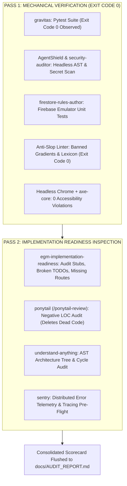

# Phase 5: 2-Pass Map-Reduce Hardening & Audit (v2.0)

**Target Time Budget**: ~45 minutes  
**Goal**: Run a structured 2-pass Map-Reduce audit, zero-trust security scan, headless accessibility sniff test, Anti-Slop linter check, and console zero-error validation to eliminate all possibility of runtime crashes during judging.

---

## The 2-Pass Map-Reduce Audit Architecture

Sprint System v2.0 replaces noisy multi-agent committee chat churn with two silent, deterministic mechanical passes:

---

## Active Tooling & Capabilities

- **`gravitas`**: Prime Directive: *"Report what actually happened, not what you intended."* Prohibits sign-off without observed test suites, exit code 0, and DOM evidence.
- **`security-auditor` & `AgentShield`**: OWASP Top 10 vulnerability checks, SQL injection checks, secret leak scanning, and least-privilege MCP capability checks.
- **`firestore-rules-author`**: Mechanical validation of declarative Firestore security rules against local emulators.
- **`egm-implementation-readiness`**: Pragmatic auditor ensuring zero placeholder stubs, unhandled edge cases, or broken API contracts remain.
- **`ponytail` (`/ponytail-review`)**: Negative LOC audit. Deletes dead code, single-use abstractions, and unneeded wrapper utilities.
- **`understand-anything`**: AST architecture tree audit. Confirms zero circular dependencies in `docs/ARCHITECTURE_TREE.md`.
- **`aas` elite bundle**:
  - `skills/aas/security-hardening.md`: Timing-safe comparisons, security headers, input sanitization.
  - `skills/aas/chaos-testing.md`: Latency injection, simulated service drop fallbacks.
  - `skills/aas/memory-leak-hunter.md`: Unclosed handles and heap growth checks.
- **`sentry` plugin**: Distributed error tracing and runtime anomaly monitoring.
- **`playwright` MCP & `e2e-testing-patterns`**: Headless end-to-end regression tests across critical user journeys.
- **`chrome-devtools-plugin`**: Verifies 0 uncaught console errors, 0 asset 404s, and inspects performance.
- **`Active Context Pruning (ACP)`**: Intercepts verbose test logs and flushes them to disk, preserving active context below 35%.

---

## Execution Checklist

1. **Pre-Phase Gate**:
   - Deliver Phase 4 Executive Scorecard.
   - Confirm security parameters and test coverage targets.
2. **Pass 1: Mechanical Verification**:
   - Run backend test suite (`pytest`): verify exit code 0.
   - Run `AgentShield` / `security-auditor`: AST scan for exposed keys, unescaped queries, and open CORS.
   - Run Anti-Slop Linter: verify exit code 0 on banned gradients, sparkles, and fake metrics.
   - Run Headless Chrome visual sniff test: verify `window.__hasError === false` and 0 accessibility violations via `axe-core`.
3. **Pass 2: Implementation Readiness & Negative LOC**:
   - Dispatch `egm-implementation-readiness`: inspect code for broken TODOs or incomplete endpoints.
   - Run `/ponytail-review`: eliminate unused imports, dead functions, and redundant wrappers.
   - Run `understand-anything`: confirm zero circular imports in `docs/ARCHITECTURE_TREE.md`.
4. **Telemetry & Error Pre-Flight**:
   - Confirm Sentry DSN configuration and trigger test event.
5. **Flush Disk Artifacts (ACP Protocol)**:
   - Compile findings into `docs/AUDIT_REPORT.md`.
   - Clear raw test scrollback from active conversational context.
6. **Phase Checkpoint**:
   - Update `SPRINT.md` with mechanical test logs for gate approval into **Phase 6 (Deployment & Launch)**.
